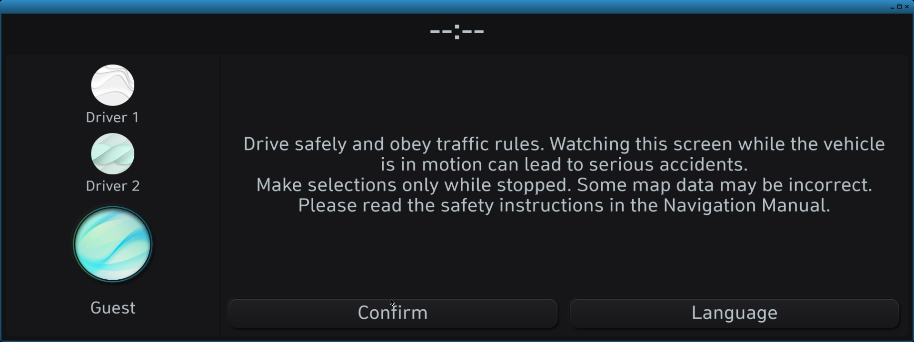
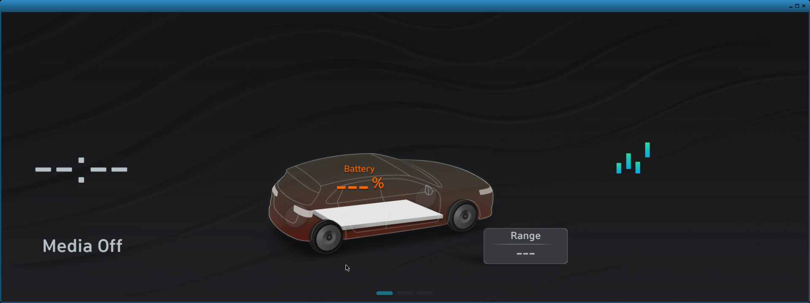
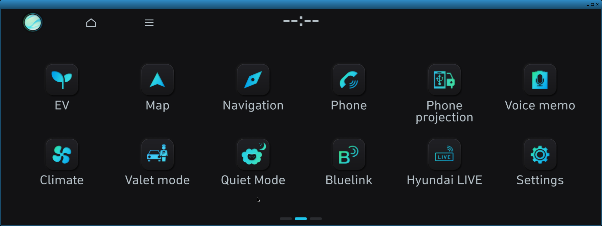

# IONIQ 5 (LG Gen5W) infotainment research

Reverse-engineering notes and tooling for the 2021 IONIQ 5 head unit, with the
goal of **running the authentic vendor firmware — unmodified — inside an isolated
QEMU VM**.

This is research documentation. It is not a jailbreak guide and does not describe
how to modify a vehicle.

#### From the parallel repository

The parallel repository publishes this same research under the title
*IONIQ 5 reverse-engineering research*; the body follows.

Research notes, source tools and validation tests for a 2021 UK-origin
Hyundai IONIQ 5 Standard Gen5W infotainment system. The documented methods
and compatibility assessments distinguish official package evidence,
owner-supplied observations and community reports.

This public repository was initialized from a sanitized snapshot with fresh
Git history. Raw diagnostic exports, device dumps and private working
records are not included. See [PUBLIC-RELEASE.md](PUBLIC-RELEASE.md) for the
publication boundary and [tests/README.md](tests/README.md) for validation.

The research documents software and subsystem behavior. It does not include
a tested vehicle modification, update procedure or claim that a community
method works on the owner's installed build.

## VM research

The [current technical handover](HANDOVER.md) records a VM-adapted boot of the
European Gen5W Linux kernel, authentic Home rendering, isolated AppNavi map
pixels, and the unresolved Home-to-Navigation transition. Authored guest
helpers and experiment scripts are in [vm/repro](vm/repro), with bounded
evidence and inspected screenshots in [vm/evidence](vm/evidence). See
[vm/README.md](vm/README.md) for the source mapping and local artifact
requirements.

## Where the project is right now

The VM boots the genuine vendor kernel and the genuine recovered userspace, and
reaches the real Hyundai home screen. Navigation is the open problem.

| Area | State | Notes |
| --- | --- | --- |
| Vendor kernel boot | **Working** | Gen5W kernel boots under QEMU with a documented ABL boot-parameter adaptation. Anti-tamper is satisfied inside the VM. |
| Recovered rootfs / userspace | **Working** | EU 2026-01-28 image decrypted offline and mounted read-only. |
| Launcher: standby → profile confirm | **Working** | Authentic driver-selection and safety-notice screen. |
| Launcher: Home screen | **Working** | Authentic `AppHomeScreen` with real tile grid. |
| AppNavi (navigation) | **Partial** | Process starts, initialises, and renders genuine map pixels into its own surface. |
| Home ↔ Navigation compositing | **Blocked** | AppNavi never becomes the foreground window; Home stays visible. See below. |
| Audio | Not started | Needs C-TRACS/audio service contracts. |
| CAN / MICOM | Partial | Local D-Bus simulation exists; real contract still being reconstructed. |
| Persistence, restart/suspend | Not started | Needs evidence-derived storage and power contracts. |
| Input (touch/keys) | Partial | Wayland input harness exists; not wired end to end. |

Everything above is measured by snapshot runs — the disk image is never written
to, and the base rootfs hash is rechecked after each experiment
(`4953a005…6d036f`).

### Where the VM work stands

| Area | State | Notes |
| --- | --- | --- |
| Vendor kernel boot | Working | Gen5W kernel boots under QEMU with a documented ABL boot-parameter adaptation; anti-tamper satisfied inside the VM |
| Recovered rootfs / userspace | Working | EU `260128` image decrypted offline; mounted read-only |
| Launcher standby → profile confirm | Working | Authentic driver-selection and safety-notice screen |
| Authentic Home screen | Working | Real `AppHomeScreen` tile grid |
| AppNavi (navigation) | Partial | Process starts and renders genuine map pixels into surface 3000 |
| Home ↔ Navigation compositing | Blocked | AppNavi never becomes the foreground window; Home stays composed |
| Audio, persistence, restart/suspend | Not started | Need evidence-derived service contracts |
| CAN / MICOM | Partial | Local D-Bus simulation exists; real contract still being reconstructed |
| Input (touch/keys) | Partial | Wayland input harness exists; not wired end to end |

### Running and interacting with the VM

Practical instructions, verified checks and a list of **false readings that have already misled this project** are in
**`docs/VM-RUNBOOK.md`**. The essentials:

- **The compositor's process name is `weston-headless`, not `weston`.** `pidof weston` returns nothing even when the
  compositor is perfectly healthy; several "the compositor died" conclusions were that check and nothing else.
- **Engineering mode launches from the developer path.** Copy `AppEngineerMode` to `/tmp/app/bin/`, then request
  **app id 301** from `com.lge.avn.applauncher` with that path on the session bus. It works, and it takes **45–70 s** to
  appear under software rendering — polling, not a short fixed sleep.
- **The VM is interactive.** The vendor module `/weston-vm-input.so` accepts `click`, `drag` and `pdrag` over
  `/tmp/weston-vm-input`, and the compositor acknowledges each with `VM_INPUT_CLICK_ACCEPTED` / `CLICK_DONE`. It must be
  listed in the compositor config (`modules=/weston-vm-input.so`) or nothing is injected at all.
- **`pid=NO_VIEW` is the black screen from the pointer's side**: the click is delivered and there is no surface under it.
  Input works; a placed, drawn view is the remaining gap.
- **False readings to avoid**: `pidof weston` (wrong name) · `wait` inside a subshell returning 127 · `ias-shot` writing
  ASCII PPM with a `.png` extension · a successful capture not proving the compositor is alive · the chain's own teardown
  killing the compositor after ~155 s.

### Downgrade — can older firmware be installed?

Short answer: **not through engineering mode on a stock unit, and not with a modified package.** Full reasoning,
evidence and the one unresolved question are in **`docs/DOWNGRADE-POSSIBILITIES.md`**.

| Route | Status |
| --- | --- |
| Engineering mode → **Force Update** | real facility — its own log line is `Force update !! Pass version compare.` — but gated by `[FORCE_UPDATE_FUCTION_ENABLE] DEV -> MP`, so **disabled on production builds** |
| Engineering mode → **Previous Version** | a *view* of prior versions, not an installer |
| FUMO **equal-version local relaunch** (`/update/usb/bin`, `force_launch=run`) | evidenced to **skip both verifier-result contracts**, but requires root write access to `/update` and leaves later model/region, payload-binding, slot, boot and health checks unproven |
| SCOMO path (`-un:1`) | its `MASS_PRODUCT`/`PENETRATION` startup **explicitly ignores** `/update/disableEncryptionUpdate` — worse, not better |
| Modified/unsigned package | **rejected** by RSA `PKCS#1` verification of `.lge.upgrade.xml`; the anchor is only replaceable from a privileged write (**V-034**) |
| **Authentic older package** | **unknown** — decided entirely by anti-rollback, which is unresolved here |

The updater's version gate is a **strict "must be newer" comparison** plus a second reference where equality is
allowed, so a lower version fails at the first gate. The mechanisms that relax it are dev-build-gated or need a
privileged write first, which is the same wall every other route meets.

**Measured against `NE_E.EUR.S5W_L.001.001.260128` (2026-01-28)** — later than late-2025, so these conclusions apply to a
recent build. Nothing has been attempted on hardware; anti-rollback is the open question that decides whether an older
*authentic* firmware would install.

### Findings summary

A single consolidated document — **`docs/FINDINGS-SUMMARY.md`** — collects the whole state: what works in the VM,
why the screenshots were striped (our own backend, proven by a clean reproduction), what DEV mode actually is, every
hidden menu and how it is triggered, the entry vectors ranked by what they require, the USB-media parser vector, what
was imported from the second project on the same platform, register reconciliation, and the dead ends.

Headline findings:

- **Clean rendering is reachable and reproduced** (`docs/vm/24-clean-vendor-backend-2026-11-04.png`); the stripes are
  produced by this project's ten-output research backend, not by the application or the compositor.
- **DEV mode is a build-state integer**, not a setting, and on this `260128` build `setEngType()` writes it
  unconditionally — so relaunching the shipped binary from `/tmp` changes nothing.
- **Engineering mode is reachable from the stock UI** by a **tap-the-software-version gesture plus a PIN**
  (`19491003` engineer, `2400` dealer), per an independent project on the same LGE Gen5W platform; the code path for
  it exists in this image. Untested here.
- **The strongest entry vector is a USB media file**: this image carries `libgstasf.so` from GStreamer 1.8.3 and a
  D-Bus-activated `lightmediascanner 0.5.1`, and the external report documents root execution from ASF/EBML payloads
  triggered by insertion alone. Filed as candidate **V-047**.

### Engineering mode and DEV mode — entry vectors and dead ends

Engineering mode on this platform is entered from the stock UI (`AppSetup` requests app id `0x12D` at `0x573194`). What the menu then shows depends on **one check**:

```c
checkSOPVersion():  cmpl $0x1, this+0x13c ; sete %al      /* true = production (SOP) menu */
```

and the only thing that writes that field is `setEngType()`, which compares the process's own executable path against the literal **`/tmp/app/bin/AppEngineerMode`**. Equal ⇒ development
state; otherwise production. **DEV mode is therefore not a setting and not a menu item — it is which file the launcher runs.** The full list it reveals adds **Encryption Update**, whose buttons call
`UpgradeVerInfo.enableUpdateFile(10)`; the production list shows only Scheduled Update List.

`AppLauncher` cooperates with this deliberately: it tests `QFile::exists("/tmp/app/bin/AppEngineerMode")` and, when the launch is for app id `0x12D`, runs that copy in preference to `/app/bin`.

| Entry vector | Status |
| --- | --- |
| Copy the binary to `/tmp/app/bin/AppEngineerMode`, then open engineering mode | **works** — measured in the projection; `readlink` showed the dev path |
| One-byte patch at file offset `0x7372a6`, `74` → `EB`, forces the develop branch always | identified, not applied |
| Stock engineering-mode entry from `AppSetup` | exists — shows the reduced SOP menu |
| USB stick carrying the file | **dead end** — `usb-automount` mounts and reports over D-Bus, never executes |
| Modified firmware through a normal update | **dead end on its own** — RSA PKCS#1 signature verification; the AES key ships in the image, the signing key does not |
| Modified firmware after replacing the trust anchor (**V-034**) | works in principle — requires a privileged local write first |
| USB Ethernet adaptor | **dead end for this image** — drivers present, but `/usr/sbin/dropbear` is absent and there is no `dropbear.socket` |

Full detail, with the disassembly and the QML quotes: **`evidence/engineering-mode-dev-activation.md`**.
The engineering application running from the dev path is captured in `docs/vm/23-engineering-mode-dev-launch-2026-11-02.png`; the launch is proven by `readlink`, and the screen itself is
striped by the rendering fault described below, so the image documents that dev mode was entered rather than what the menu says.

### Display investigation — current state

The application renders: it calls `QWindow::show()`, creates a Wayland surface, attaches a buffer and commits, and the compositor reports a real window for it
(`Surface id(…), Weston surface W(1926), H(753)`). Making it *visible* requires an explicit request — `ivi_wm` sends `set_surface_layout`, `set_surface_visible` and `request_fg`
through the vendor's own `ivi_window_manager` interface, and that request is what makes content appear at all.

The composite is **correct** when the application is forced onto Qt Quick's software renderer
(`QT_QUICK_BACKEND=software`, `docs/vm/16-software-backend-no-shear-2026-10-31.png`), which produces clean 1920×720 geometry. That single substitution exonerates the
compositor, its pixman renderer, the research backend and the placement work. The software path cannot show the **vendor UI**, because the application's own texture factory
fails for every image when not on GL (`UncompressedTextureFactory::createTexture … Fail`).

So the shear is confined to the EGL path. The standing explanation is arithmetic: the application's window is **1926 wide with stride 7704** while the compositor assumes the
**1920**-wide screen at **7680** — 24 bytes, six pixels, per row. The chain that produces it is measured in pieces: the application asks for the primary screen size and receives
**0×0**, and it never receives an `ivi_surface.configure`, so it cannot size itself to the screen. The drift itself has **not** been confirmed at the pixel level; frames are
noise-like after it and cross-correlation was inconclusive.

Its pixels travel in a single ~5.8 MB `mesa-shared` segment plus three 20 KB `weston-shared` state segments, not in a Wayland `wl_shm` pool — which is why scanning
`/proc/<pid>` for a shared-memory frame found nothing.

**Latest state: the shear has been removed by rewriting one expression.** The vendor's own quad vertex
shader was recovered from the running process (`glShaderSource` interception) and is:

```glsl
attribute vec4 position;
attribute vec4 texCoords;
varying vec2 outTexCoords;
void main() { gl_Position = position; outTexCoords = texCoords.xy; }
```

Rewriting the last line in memory, at upload, changes the result completely:
`outTexCoords = texCoords.yx;` merely rearranges the stripes, while
`outTexCoords = vec2(-texCoords.x, texCoords.y);` **removes them entirely**, yielding a clean window
(`docs/vm/21-flipu-removes-shear-2026-10-31.png`). So the artefact comes from the sign of the `u`
coordinate the application supplies. The corrected frame is mostly empty, which means the mapping is not a
pure mirror; bracketing it with a short sweep of `a·u + b` candidates is the remaining work, and each
candidate now costs one run. No vendor binary is modified — the rewrite happens in memory, by an
interposer installed only in the research clone.

**What is not available here:** weston's GL renderer. The vendor's `headless-backend.so` rejects `--use-gl` outright (`fatal: unhandled option`), so the EGL path cannot be
tested against a renderer that can sample GL buffers, and the vendor `ias-backend.so` needs hardware this VM does not have.

### Recently established (2026-10-31)

Work in the merge of the two lineages resolved several faults that had been blocking
reproducible rendering, and produced tools that are now part of the repository.

| Finding | Evidence |
| --- | --- |
| The vendor IVI shell integration **silently declines to create a Wayland surface** unless it is given a surface id. With the launcher's `QT_WAYLAND_SET_SURFACE_ID=0` the client enters `IviShellIntegration::createShellSurface`, returns, and never calls the surface creator. | `Ioniq5-CHANGELOG.md` 2.64.0; `tools/uk_fw/ias_backend_soft/qt_show_trace.c` |
| Forcing one id onto the app **collides** with the ids of its other surfaces: the compositor raises `id_surface(1) is already created`, the connection dies with a fatal protocol error, and the resulting teardown is what previously looked like two unrelated crashes in `free()` and in a widget destructor. | 2.72.0, 2.73.0 |
| `QT_WAYLAND_USE_PID_FOR_SURFACE_ID=1` gives each client a unique id (its pid). The application then **stays alive indefinitely** and the compositor reports a real window: `Surface id(778), Weston surface W(1926), H(753)`. | 2.73.0 |
| The vendor compositor **aborts** when more than one IVI screen exists: `pixman-renderer.c:277 composite_clipped: Assertion 'src_format' failed`. The cause is its own solid-colour backgrounds, which have no pixmap format. An interposer supplies one. | 2.53.0; `tools/uk_fw/ias_backend_soft/pixman_solid_shim.c` |
| `hmi-controller.so` ships but **never loads** without nine `[ivi-shell]` config keys; with them it initialises. | 2.55.0 |
| The vendor ships its own window-manager protocol (`/usr/share/ivi-window-manager/ivi-window-manager.xml`) with `set_surface_visible`, `request_fg` and `set_surface_layout` — the placement vocabulary this project had been hand-rolling. | 2.69.0; `tools/uk_fw/ias_backend_soft/ivi_wm.c` |
| `org.genivi.persistence.admin` is **absent** from the image although clients link its library; a stub now provides it. Supplying it does **not** stop the client crashes — a refuted hypothesis, recorded as such. | 2.59.0, 2.61.0; `persistence_admin_stub.c` |

New tools in `tools/uk_fw/ias_backend_soft/`: `qt_show_trace.c` (traces `QWindow::show`, the vendor shell surface calls and the HMI
id request), `qt_env_shim.c` (environment interposer), `pixman_solid_shim.c`, `ivi_wm.c`, `ivi_place.c`, `persistence_admin_stub.c`.

Two capabilities were added to the research backend for this work: `IAS_OUTPUT_COUNT` (present N IVI screens, which is what the
vendor shell numbers screens by) and `IAS_REPAINT_OUTPUTS` / `IAS_SHIM` (limit which outputs composite, and disable the research
surface shim), all defaulting to previous behaviour.

**A caveat stated plainly:** the authentic Home screen capture in this README (`docs/vm/02-home-screen.png`) came from the earlier
configuration. In the ten-screen research backend used for this week's work the composited frame still measures black
(max channel value 8 of 255) even with the application's surface created and committed, so "Home renders" and "this particular backend
shows it" are not the same claim, and the second is not established.

**Security:** the same work produced register entry **V-046**, a *candidate*: every request in the vendor window-manager interface
names its target by surface id rather than by calling client, which would permit cross-client window control unless the compositor
validates the sender. No cross-client attempt has been made yet, and the entry says so.

Runs use QEMU with TCG acceleration, `-cpu max,vendor=GenuineIntel`, 1536 MiB RAM,
disk `snapshot=on`, and **no NIC**. Snapshot mode is mandatory: a run must never
mutate the base image or reach the network.

## Screenshots

All frames are Wayland framebuffer captures from the running VM, at the head
unit's real 1920×720 geometry.

### 1. Profile / confirm screen


Produced by the genuine launcher, not a mock-up. Driver 1 / Driver 2 / Guest
selection with the real safety notice and Confirm / Language buttons.

### 2. Authentic Home screen


The real `AppHomeScreen`: EV, Map, Navigation, Phone, Phone projection, Voice
memo, Climate, Valet mode, Quiet Mode, Bluelink, Hyundai LIVE, Settings — with
the genuine top bar (profile orb, home, menu).

### 3. Attempted navigation, still showing Home


The honest failure case. This frame was captured during the navigation window.
Only the page-indicator dots changed; Home remains composed. This is the visible
symptom of the ApplicationManager state problem described below.

### 4. Genuine AppNavi map pixels


Rendered by the authentic AppNavi binary into surface `3000`: real road network,
river, and the red position arrow. The map surface only occupies part of the
width, so the right-hand region is empty.

#### From the parallel repository

The parallel repository files these four frames under the heading
`### Inspected screenshots`.

All frames are Wayland framebuffer captures at the head unit's real 1920×720
geometry, taken from the running VM. The same four frames are published under
`vm/evidence/screenshots/`:

**Authentic profile / confirm screen** — produced by the genuine launcher, not a
mock-up.



**Authentic `AppHomeScreen`** — the real tile grid and top bar.



**Attempted navigation, still showing Home** — the honest failure case. This
frame was captured during the navigation window; only the page-indicator dots
changed.



**Genuine AppNavi map pixels** — real road network, river and position arrow,
rendered by the authentic binary into its own surface.


## Why Navigation does not appear yet

This is the current focus, and it is a contract problem rather than a rendering
problem. Recovered from disassembly plus runtime traces:

- AppNavi calls launcher `launched(30)`, then separately emits
  `SendNaviBootFail(5)` on `/navigation_map`. The `5` is a hard-coded literal, not
  derived from an engine result.
- ApplicationManager caches that status, but gates downstream handling on a
  *separate* window byte. That byte stays `0`, so the manager returns to
  `11/11` instead of settling in `APP_NAVI` (`30`).
- Only a **background** (BG) window notification updates that byte, and the
  observed runtime only delivers **foreground** (FG).
- The compositor rule is now known: **any positive width or height selects FG**;
  BG requires both dimensions non-positive. So "fixing" geometry from 1926×753 to
  1920×720 would not change the outcome.
- The BG path is not hypothetical: positive Camera/Standby controls were observed
  driving `1926×753 → 0×0 → BG → slotNotifyBGInfo`.

Open question: does AppNavi's genuine Qt `hide()`/null-buffer attach ever occur in
this stack, and can the VM legitimately produce the BG notification?

Deliberate non-actions: the status is not patched, the window flag is not forced,
and no success callback is synthesised.

#### From the parallel repository

The current state, with the measured evidence behind it, is documented in
[docs/navigation-status.md](docs/navigation-status.md). In short: the EGL dimension
ordering defect and the "a hide is not a background notification" result are both
measured now, and the remaining blocker is that AppNavi never attaches a surface, so
nothing reaches the compositor to be classified.

A contract problem, not a rendering problem — the same trace, worded from the
parallel record:

- AppNavi calls launcher `launched(30)`, then separately emits
  `SendNaviBootFail(5)` on `/navigation_map`; the `5` is a hard-coded literal.
- ApplicationManager caches that status but gates downstream handling on a
  separate window byte, which stays `0`, so the manager returns to `11/11`
  instead of settling in `APP_NAVI` (`30`).
- Only a **background** window notification updates that byte; the observed
  runtime delivers **foreground** only.
- The compositor selects FG for any positive width *or* height; BG requires both
  non-positive. Geometry changes therefore cannot fix this branch.
- The BG path is not hypothetical: positive Camera/Standby controls were observed
  driving `1926×753 → 0×0 → BG → slotNotifyBGInfo`.

## Running it

VM control lives in `tools/uk_fw/vm_boot.py`; boot-contract details are in
`evidence/`. The working configuration:

- QEMU with TCG acceleration
- CPU `max,vendor=GenuineIntel`
- 1536 MiB RAM
- disk `snapshot=on`
- **no NIC**

Snapshot mode with no networking is a hard requirement: runs must not mutate the
base image or reach the network.

## Exact-static update-trust and boot boundaries

Recent execution-free work has advanced four adjacent parts of the recovered
FUMO updater without running it or constructing update material:

- [Wildcard recovery-signal boundary](evidence/appfumo-dbus-recovery-signal-boundary.md)
  binds the empty-service/path Qt 5 subscription, guarded local consumer,
  canonical system-bus policy (including the uid-conditioned paired
  default-deny/root-allow sender rule), launcher identity, and
  SMACK/runtime-reachability boundary without publishing callable D-Bus
  coordinates or values.
- [Parameterized verifier provenance](evidence/appfumo-parameterized-verifier-provenance.md)
  resolves two formerly unknown direct verifier operands as one nested
  controller-resource route. Verification and transformation reuse a pathname
  value but independently reopen it, so same-object and same-byte continuity
  remain unproved.
- [Partition-write integrity](evidence/appfumo-partition-write-integrity.md)
  maps the source-integrity gate, its non-hash mode, inactive-target selection,
  and the write-completion boundary. Source verification is pre-write; no
  cryptographic readback of final inactive-partition bytes was found in the
  reviewed direct route.
- [Boot-activation boundary](evidence/appfumo-boot-activation-boundary.md)
  binds the completion QML and Qt dispatch chain to a local asynchronous reset
  request, separately maps reboot-system and recovery requests, and streams the
  canonical rootfs inventory. None of those requests carries a slot identifier
  or proves hardware action.

Together these results narrow the remaining boundary to same-bus runtime
reachability and labels, runtime pathname immutability, and external
MICOM/ABL/bootloader behavior. They do not establish an accepted modified
update, inactive-slot activation, mark-good, rollback, code execution, root
access, or persistence.

## Combined repository history

The two previously parallel public repositories now share the same combined
history. Their original lineages remain reachable through the merge ancestry;
no branch was squashed or replaced to perform the combination. This README
retains the highlights and evidence links from both bodies of work, and the
same reviewed combined commit is published to both repository remotes.

## Validation

```sh
python3 tests/run_all.py        # integrated read-only harness
python3 -m unittest discover -s tests
```

The harness checks the research ledger, artifact hashes, JSON validity, Council
packets, privacy rules and documentation scope. In public mode it inspects only
Git-indexed files.

## Project records

| File | Purpose |
| --- | --- |
| `HANDOVER.md` | Current checkpoint and next bounded task |
| `Ioniq5-CHANGELOG.md` | Editable, newest-first summary |
| `Ioniq5-HISTORY.md` | **Append-only** research history; corrections are appended, never rewritten |
| `Ioniq5-research-plan.md` | Scope, confidentiality and non-actuation boundaries |
| `evidence/` | Source-labelled findings with provenance |
| `PUBLIC-RELEASE.md` | What this public tree excludes, and the publication gate |

## Scope and confidentiality

This repository contains sanitised research findings only. Raw vehicle exports,
decrypted firmware, full core dumps, driving traces and third-party paper
artifacts are deliberately excluded and remain in a private archive. See
`PUBLIC-RELEASE.md` for the exact exclusion list and the conditions that must be
met before the repository is made public.

Security findings that could affect real vehicles are tracked in a separate
register outside this public tree and are handled under coordinated-disclosure
rules.

## Latest bring-up — 2026-10-31

State after a long session working the VM end to end. Everything below was measured, not assumed; the
scaffold and its hand-off notes live in `tools/uk_fw/ias_backend_soft/`.

### What now works

- **Authentic boot chain**: `init=/lib/systemd/esinit` reaches `Reached target Multi-User System`. Two vendor
  defects had to be worked around in a copy-on-write clone and both are recorded: `check-mount.sh` ships mode
  `0644` (no execute bit) and eleven `fstab` entries demand `mmcblk0pN` partitions the projection lacks.
- **Our own Weston backend** (`ias-backend-soft.so`): the vendor `weston` runs it with `ias-shell.so`, publishes
  `ias_crtc`/`ias_mode`, and `wrandr` reports `CRTC = 1, 1920x720 @ 60000`. The shipped compositor is
  **LG-patched**: `struct weston_output` differs from upstream 1.10 by `0x18` bytes, so a plugin built against
  upstream headers initialises fields in the wrong place and crashes it — `vendor-abi.patch` restores the layout.
- **EGL**: the image ships **no software rasteriser**, only Intel DRI. Injecting Debian `swrast_dri.so` with
  `libLLVM-3.9` and setting `LIBGL_DRIVERS_PATH`/`MESA_LOADER_DRIVER_OVERRIDE=swrast` is what makes GL work.
- **Frame capture**: a `weston_screenshooter` client plus a backend framebuffer dump. `--use-pixman` is
  mandatory, because the default renderer cannot read pixels back.
- **MICOM adaptors**: `micom-responder` provides the `/dev/ttyS1` peer (the guest is missing `/dev/pts`, so it
  runs on a pty) and `micom-service` owns `com.lge.car.micom` on the session-independent system bus. With them,
  the launcher reaches readiness for the first time:

  ```
  [  OK  ] Started HKMC Preminum AVN 2.1 -Launcher.
  micom-svc: AskSysBootinfo -> 35 bytes
  ApplicationLauncher::getAppProcessByAppId appId[2][ApplicationManager]
  ```

### What is still blocked, and why

The launcher registers and begins dispatching, then loops on `appId[2][ApplicationManager]` because
`ApplicationManager` cannot initialise boot information — it reports `initMicomShareMem() -> pszSrc NULL`.
Seven environmental hypotheses have been excluded by measurement (bus reachability, interface construction,
file-backed segments, peer presence, payload content, `/dev/shm`, segment existence). What remains is the
**layout and validity rules of the MICOM status structure**, which is disassembly work on a stripped binary.
Register entry **V-036** records this, with the elimination list and the anchors.

Because the client commits surfaces but never attaches a buffer, the HMI frame itself is black. That is
recorded honestly rather than cropped out — the control image is the evidence that the compositor renders.

### Vendor graphics rendered in the VM

Running the reproduction chain published in `vm/repro/` (`full-chain-authentic-standby.sh`) produces a live
`AppHomeScreen` and a compositor that paints **vendor artwork at 1920×720**. Captured from the running VM with the
image's own `/usr/libexec/weston-screenshooter`:


That is the Hyundai boot splash (`/app/share/SplashScreen/8bit_booting_2022NEWHMC_NA_NA_1920.png`, linked to
`/tmp/front_lcd.png` by the chain), rendered by the vendor compositor through `weston-headless` with `ivi-shell.so`.
The same run had `AppHomeScreen` alive (`pid 849`) and the launcher dispatching; at 155 s the compositor is still
showing this splash layer rather than home tiles, so the next question is the transition out of it, not whether the
stack can paint.

Four details of that chain were decisive and none were guessable: `ivi-shell.so` rather than `ias-shell`,
software EGL from `/opt/software-egl18` with `GALLIUM_DRIVER=softpipe`, `QT_WAYLAND_SHELL_INTEGRATION` unset
(AppLauncher appends `:ivi`, producing the invalid `ivi:ivi`), and `/etc/passwd.legacy` copied to `/tmp/passwd` with the
`xuser` and `byungsu` accounts added.

| Compositor control (`weston-simple-shm`) | Current HMI frame from this session's own chain |
| --- | --- |
|  |  |
| Test pattern rendered by the vendor compositor through our backend — **173 distinct colours**, proving the whole path from backend to framebuffer works. | `AppHomeScreen` running with its surfaces mapped: uniformly black because no buffer is ever attached. `initMicomShareMem() -> pszSrc NULL` is why the launcher's dispatch never completes. |

Both frames are downscaled dumps of the backend framebuffer (240×90 natively, shown here upscaled 4×), moved out of
the guest over a `-chardev file` serial port — console transfer corrupts above roughly 8 KB, which is why that channel
is used.
