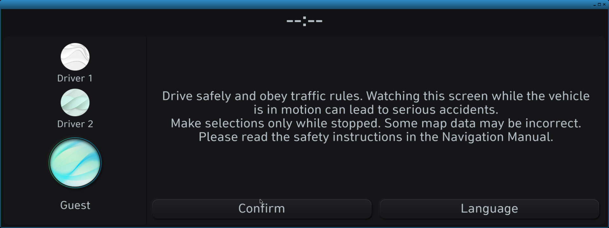
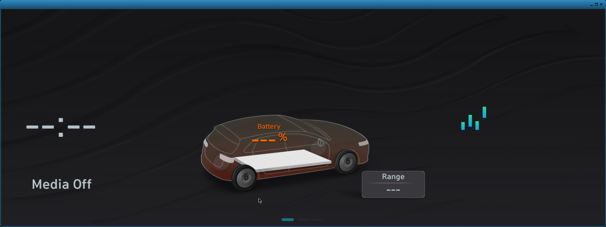

# IONIQ 5 reverse-engineering research

Research notes, source tools and validation tests for a 2021 UK-origin
Hyundai IONIQ 5 Standard Gen5W infotainment system. The documented methods
and compatibility assessments distinguish official package evidence,
owner-supplied observations and community reports.

This public repository was initialized from a sanitized snapshot with fresh
Git history. Raw diagnostic exports, device dumps and private working
records are not included. See [PUBLIC-RELEASE.md](PUBLIC-RELEASE.md) for the
publication boundary and [tests/README.md](tests/README.md) for validation.

The research documents software and subsystem behavior. It does not include
a tested vehicle modification, update procedure or claim that a community
method works on the owner's installed build.

## VM research

The [current technical handover](HANDOVER.md) records a VM-adapted boot of the
European Gen5W Linux kernel, authentic Home rendering, isolated AppNavi map
pixels, and the unresolved Home-to-Navigation transition. Authored guest
helpers and experiment scripts are in [vm/repro](vm/repro), with bounded
evidence and inspected screenshots in [vm/evidence](vm/evidence). See
[vm/README.md](vm/README.md) for the source mapping and local artifact
requirements.

### Where the VM work stands

| Area | State | Notes |
| --- | --- | --- |
| Vendor kernel boot | Working | Gen5W kernel boots under QEMU with a documented ABL boot-parameter adaptation; anti-tamper satisfied inside the VM |
| Recovered rootfs / userspace | Working | EU `260128` image decrypted offline; mounted read-only |
| Launcher standby → profile confirm | Working | Authentic driver-selection and safety-notice screen |
| Authentic Home screen | Working | Real `AppHomeScreen` tile grid |
| AppNavi (navigation) | Partial | Process starts and renders genuine map pixels into surface 3000 |
| Home ↔ Navigation compositing | Blocked | AppNavi never becomes the foreground window; Home stays composed |
| Audio, persistence, restart/suspend | Not started | Need evidence-derived service contracts |
| CAN / MICOM | Partial | Local D-Bus simulation exists; real contract still being reconstructed |
| Input (touch/keys) | Partial | Wayland input harness exists; not wired end to end |

Runs use QEMU with TCG acceleration, `-cpu max,vendor=GenuineIntel`, 1536 MiB RAM,
disk `snapshot=on`, and **no NIC**. Snapshot mode is mandatory: a run must never
mutate the base image or reach the network.

### Inspected screenshots

All frames are Wayland framebuffer captures at the head unit's real 1920×720
geometry, taken from the running VM.

**Authentic profile / confirm screen** — produced by the genuine launcher, not a
mock-up.

**Authentic `AppHomeScreen`** — the real tile grid and top bar.

**Attempted navigation, still showing Home** — the honest failure case. This
frame was captured during the navigation window; only the page-indicator dots
changed.

**Genuine AppNavi map pixels** — real road network, river and position arrow,
rendered by the authentic binary into its own surface.

### Why Navigation does not appear yet

The current state, with the measured evidence behind it, is documented in
[docs/navigation-status.md](docs/navigation-status.md). In short: the EGL dimension
ordering defect and the "a hide is not a background notification" result are both
measured now, and the remaining blocker is that AppNavi never attaches a surface, so
nothing reaches the compositor to be classified.

A contract problem, not a rendering problem:

- AppNavi calls launcher `launched(30)`, then separately emits
  `SendNaviBootFail(5)` on `/navigation_map`; the `5` is a hard-coded literal.
- ApplicationManager caches that status but gates downstream handling on a
  separate window byte, which stays `0`, so the manager returns to `11/11`
  instead of settling in `APP_NAVI` (`30`).
- Only a **background** window notification updates that byte; the observed
  runtime delivers **foreground** only.
- The compositor selects FG for any positive width *or* height; BG requires both
  non-positive. Geometry changes therefore cannot fix this branch.
- The BG path is not hypothetical: positive Camera/Standby controls were observed
  driving `1926×753 → 0×0 → BG → slotNotifyBGInfo`.

Deliberate non-actions: the status is not patched, the window flag is not forced,
and no success callback is synthesised.
