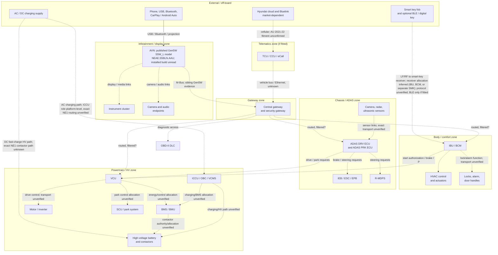

# 2021 Australian Hyundai Ioniq 5 (NE1): Vehicle-System Architecture and Trust-Boundary Map

Status: local/private research dossier. No external publication.

Research cut-off and source access date: 2026-10-19 (Australia/Sydney). Some pages were first retrieved on 2026-10-18 and rechecked on 2026-10-19.

Scope: conceptual vehicle-system map for a 2021-23 Australian-market Hyundai Ioniq 5 (NE1). The accepted infotainment context is used as the anchor: Standard Gen5W S5W_L Linux, model `NEAE.S5BLN.AAU`, current published Australian software `NE_E.AUS.S5W_L.001.001.260319`. The map covers infotainment/AVN, telematics/TCU/Bluelink, central/security gateway, OBD/DLC/diagnostics, body controller, smart key/keyless/immobilizer/start authorization, cluster, ADAS sensing/domain, braking/steering/chassis, VCU/drivetrain, BMS/high-voltage/charging, HVAC, camera/audio, and the network domains that can be sourced.

Safety boundary: this document is architecture and research only. It contains no frame IDs, payloads, diagnostic seed/key values, credentials, replay or unlock procedures, immobilizer defeat, start bypass, or safety-control disable instructions. The smart-key, immobilizer, ADAS, braking, steering, and high-voltage systems are treated as systems with their own authority and failure modes, not as generic warnings.

## 1. Bottom line

1. The exact Australian infotainment anchor is confirmed at the published-build level: the Hyundai Australia update table lists the 2021-23 IONIQ 5 as Standard Gen5W Navigation, published software `NE_E.AUS.S5W_L.001.001.260319`, model `NEAE.S5BLN.AAU` [S6]. The installed build on a specific car is not established by that table and must be read from the vehicle.

2. The 2021 Australian specification sheet documents the car as a smart-key, push-button-start EV with an engine immobilizer, a 12.3-inch cluster, a BOSE external amplifier, Integrated Electric Booster (IEB) brakes, rack-mounted Motor Driven Power Steering (R-MDPS), ESC, PTC heater, CCS2 charging, and a 72.6 kWh / 653 V battery [S1]. Those are exact Australian launch-spec statements, not foreign-market inference.

3. Australian 2021-22 NE1 telematics fitment is unresolved, not excluded. The September 2021 Australian specification sheet does not list Bluelink [S1]. Hyundai Australia's own Bluelink article says the service debuted with the 2023 Palisade and then rolled out across the range [S5]. An October 2021 Australian review of the 2022 model states there was no remote-access application and that Hyundai was working to bring Blue Link to Australia [S38]. A Hyundai Australia dealer response reproduced in an App Store review in December 2023 states that Bluelink was not then fitted to the Australian IONIQ 5 [S40]. Those sources support "not established" and "do not assume fitted"; they are not affirmative VIN-specific proof that a given 2021-22 car lacks cellular hardware. The global/Australian launch release describes Bluelink capability, but that is not proof of Australian fitment [S2].

4. A central gateway/security-gateway function is evidenced for NE1 by independent diagnostic sources, not by a public Hyundai service manual. Delphi's May 2026 diagnostic release lists Hyundai Ioniq5 2022-2023 under "Security Gateway" secured access [S25]. DAP4CS lists the Hyundai Ioniq 5 (NE EV) among vehicles with Hyundai/Kia Security Gateway and describes the SGW as a central-gateway feature that authorizes special diagnostic functions [S26]. Hyundai patent filings describe a gateway that routes CAN, LIN, MOST, FlexRay, and Ethernet with certificate-based access control and TPM/HSM storage [S23], and a second design that verifies a MAC on encrypted messages before routing [S24]. The exact NE1 packaging, routing table, and filter rules remain unpublished.

5. The best public infotainment exploit research is family-level, not NE1-level. Costantino, De Vincenzi, and Matteucci tested a Gen5W_L unit in a Hyundai Ioniq Electric (AE) running firmware `AE_E_PE_EUR.S5W_L001.001.211214`, not an Ioniq 5 [S18]. They document firmware decryption-key leakage, a signature-check bypass, custom firmware installation, and CAN injection into the M-Bus; their summary also claims effects on the B-Bus and C-Bus, but the detailed evidence is strongest for the M-Bus and the in-unit micom path [S18]. Treat "IVI can reach chassis/body buses on NE1" as plausible and unresolved, not as a proven NE1 fact.

6. The smart-key/immobilizer chain is a first-class authorization system with a documented Ioniq 5 weakness. Hyundai UK states that unauthorised electronic devices have been used to bypass vehicle locking systems and offers a subsidised software-and-hardware upgrade for GBP 49 [S20]. The Verge and The Guardian report some UK Ioniq 5 vehicles being entered and started with a key-emulation device, distinct from a classic relay attack, and Hyundai's response refers to vehicles sold from February 2024 having the latest updates [S21][S22]. Australian applicability is not established by those sources; no Australian recall or bulletin for this specific upgrade was found in the bounded search.

7. Safety-critical domains are locally controlled, but the specific safety monitors and ASIL allocations are not public. Software still has safety authority. The Australian ICCU recall says a software issue in the Integrated Charging Control Unit can stop the auxiliary 12 V battery charging, causing drainage and loss of motive power; the remedy is a software update [S13]. The Australian SCU recall says a Shift Control Unit software issue can fail the parking pawl [S14]. These are not adversarial exploits, but they show that charging, 12 V supply, park, and drivetrain availability are software-mediated safety functions.

8. The largest unresolved architecture question is not "is there a gateway?" but "what does the gateway actually filter?" A gateway that authorizes diagnostic actuator tests does not necessarily block normal broadcast frames originating from the infotainment bus. No public NE1 source establishes the allowlist, the AVN-to-gateway physical transport, or whether IVI-originated frames can reach body, chassis, or powertrain domains.

## 2. Source-strength labels and method

Source-strength labels used in this dossier:

- A: Official Hyundai/Hyundai Motor Group, an Australian regulator, an Australian government body, or a standards body. Directly applicable unless the row says otherwise.
- B: Peer-reviewed or primary security research, CVE/advisory record, or a primary legal/technical document that is not vehicle-specific.
- C: Reputable industry, teardown, diagnostic-vendor, or journalism source. Useful for architecture, not OEM-equivalent.
- D: Community, enthusiast, forum, resale, or AI-assisted labor source. Hypothesis-generating only.
- E: Analyst inference from the cited facts. Never presented as an observed fact.

Method: public-source research only. No live vehicle access, no diagnostic session, no network capture, no key or immobilizer interaction, and no attempt to reproduce any exploit. Searches were run against Hyundai global/Australian/UK sites, the Australian vehicle-recall register, NHTSA TSB reproductions, standards pages, CVE/advisory records, peer-reviewed research, teardown summaries, diagnostic-vendor documentation, and community CAN notes. Where sources conflict, the conflict is stated rather than averaged away.

Regulatory frame: ISO/SAE 21434 and UN R155 describe cybersecurity engineering and cybersecurity-management-system expectations [S32][S33]. They are useful for judging what evidence a manufacturer should hold, but this research found no public evidence that the 2021 Australian NE1 was type-approved to UN R155 or assessed against ISO/SAE 21434. The Australian Department of Infrastructure's connected-vehicle page points to the Privacy Act 1988 and the Australian Privacy Principles for personal information, not to a public NE1 cybersecurity certification [S34][S35]. Do not infer certification from the presence of a gateway or an immobilizer.

## 3. Source register

All URLs were accessed on 2026-10-19 unless a publication date is given. "A" sources are official/regulatory/standards; "B" peer-reviewed or primary advisory; "C" industry/vendor/journalism; "D" community/AI-assisted. The exact source-to-claim mapping is in the subsystem table and the registers below.

| ID | Strength | Source and date | What it supports |
|---|---|---|---|
| S1 | A | Hyundai Australia, "IONIQ 5 Specifications", September 2021, https://www.hyundai.com/content/dam/hyundai/au/en/models/ioniq5/images/IONIQ5_SpecTable_Sept_2021.pdf | Australian launch specification: smart key/push start, immobilizer, 12.3-inch cluster, BOSE external amp, IEB, ESC, R-MDPS, PTC, CCS2, 72.6 kWh/653 V, no Bluelink row. |
| S2 | A | Hyundai Australia, "IONIQ 5 redefines electric mobility lifestyle", 2021, https://www.hyundai.com/au/en/news/mobility/hyundai-IONIQ-5-redefines-electric-mobility-lifestyle | Global/Australian launch copy; describes Bluelink capability and SmartSense functions; not proof of Australian fitment. |
| S3 | A | Hyundai Australia, "Bluelink", accessed 2026-10-19, https://www.hyundai.com/au/en/owning/bluelink | Bluelink works through an embedded modem and SIM; remote lock/unlock, climate, status, digital-key availability. |
| S4 | A | Hyundai Australia, "Bluelink Privacy Collection Notice", accessed 2026-10-19, https://www.hyundai.com/au/en/customer-care/customer-charter/bluelink-privacy-collection-notice | VIN-linked vehicle data is personal information; remote diagnostics, OTA, emergency calls, disclosure to dealers/providers. |
| S5 | A | Hyundai Australia, "Introducing Hyundai Bluelink", 2022, https://www.hyundai.com/au/en/news/features-and-how-to/introducing-hyundai-bluelink-the-future-at-your-fingertips | Bluelink debuted with the 2023 Palisade (Q3 2022) and rolled out gradually. |
| S6 | A | Hyundai Australia navigation update table, accessed 2026-10-19, https://update.hyundai.com/AU/EN/updateNoticePopup/aiD0Sq | Exact 2021-23 IONIQ 5 head-unit model and published software: Standard Gen5W, `NE_E.AUS.S5W_L.001.001.260319`, `NEAE.S5BLN.AAU`. Does not establish the installed build. |
| S7 | A | Hyundai NE1 Owner's Manual (2024 edition), "Immobilizer System", https://ownersmanual.hyundai.com/full_webhelp/NE1/2024/en_US/id1bdffbafad3.html | Immobilizer disables the vehicle if key coding is not recognized; key/immobilizer password confidentiality. |
| S8 | A | Hyundai NE1 Owner's Manual (2024 edition), "Smart Key", https://ownersmanual.hyundai.com/full_webhelp/NE1/2024/en_US/ide432b5a68eb.html | Smart-key door proximity 0.7-1.0 m, remote start within 10 m, remote start/RSPA/charge-door functions, key registration limit. |
| S9 | A | Hyundai NE1 Owner's Manual (2024 edition), "Starting the Vehicle", https://ownersmanual.hyundai.com/full_webhelp/NE1/2024/en_US/idb9770c63bcd.html | Start only with smart key in vehicle; brake/P/start-button preconditions. |
| S10 | A | Hyundai NE1 Owner's Manual (2024 edition), "Fuse/Relay Panel Description", https://ownersmanual.hyundai.com/full_webhelp/NE1/2024/en_US/id081b71b2ae1.html | Exact NE1 module names: VCU, IBU, ICU junction block, ICCU, VCMS, BMU/BMS, SCU, MDPS, IEB, ADAS Driving ECU, ADAS Parking ECU, front/rear corner radar, front radar, front camera, cluster, AVN, E-CALL, AMP, IAU/BLE. |
| S11 | A | Hyundai TSB 23-01-014H-6, November 2023, https://static.nhtsa.gov/odi/tsbs/2023/MC-10245579-0001.pdf | IBU/BCM software update for burglar-alarm operation and ignition-start logic. The applicable-vehicle list is vehicles without an immobilizer and without a START/STOP button; the IONIQ 5 is not on that list. Used only as generic Hyundai IBU/BCM architecture evidence. |
| S12 | A | Hyundai TSB 24-EV-004H, July 2024, https://static.nhtsa.gov/odi/tsbs/2024/MC-11006095-0001.pdf | ICCU replacement context, DC-DC charging concern, ICCU fuse/EV battery relationship; 2022-2024 NE1. |
| S13 | A | Australian Vehicle Recalls, REC-006224, 20 December 2024, https://www.vehiclerecalls.gov.au/recalls/rec-006224 | Australian NE1/CE1 ICCU software issue: 12 V battery may not charge, loss of motive power; software remedy; supersedes REC-005942. |
| S14 | A | Australian Vehicle Recalls, REC-005448, 6 June 2022, https://www.vehiclerecalls.gov.au/recalls/rec-005448 | Australian 2021-22 NE1 SCU software issue: parking pawl may fail; software remedy. |
| S15 | A | Australian Vehicle Recalls, REC-005940, 11 April 2024, https://www.vehiclerecalls.gov.au/recalls/rec-005940 | 2023 NE1/CE1 driveshaft manufacturing issue; sudden loss of motive power; replacement remedy. |
| S16 | A | Hyundai Motor Group, "E-GMP" launch release, 2 December 2020, https://www.hyundai.com/worldwide/en/newsroom/detail/0000000812 | E-GMP is the IONIQ 5 platform; ICCU multi-charging and bidirectional conversion. |
| S17 | A | Hyundai Motor Group, "The Crux of Mobility's Sustainable Future", 17 January 2022, https://www.hyundaimotorgroup.com/en/story/CONT0000000000005041 | VCU controls motor, regenerative braking, climate control, vehicle electronics and power supply; ICCU and VCMS roles. |
| S18 | B | Costantino, De Vincenzi, Matteucci, "A vehicle firmware security vulnerability: an IVI exploitation", Journal of Computer Virology and Hacking Techniques 20:681-696, published 8 May 2024, https://link.springer.com/article/10.1007/s11416-024-00522-4 | Gen5W_L firmware exploitation, signature bypass, custom firmware, CAN injection; tested on a Hyundai Ioniq Electric (AE), not NE1. |
| S19 | B | GitHub Advisory Database, CVE-2023-26243, published 27 April 2023, https://github.com/advisories/GHSA-68w8-q32v-4g44 | Gen5W_L decryptor leaks AES key/IV; custom firmware; backdoor potential if Wi-Fi connected. |
| S20 | A | Hyundai Motor UK, "Security and locking systems", accessed 2026-10-19, https://www.hyundai.com/uk/en/owners/owning-a-hyundai/security-and-locking-systems.html | UK Ioniq 5 optional security upgrade; unauthorised electronic devices bypass locking; GBP 49 software-and-hardware upgrade. |
| S21 | C | The Verge, 11 August 2025, https://www.theverge.com/news/757205/hyundai-ioniq-5-security-upgrade-fix-game-boy-device-attacks | UK Ioniq 5 keyless-entry/start weakness; paid upgrade; relationship to earlier key-emulation reports. |
| S22 | C | The Guardian, 29 March 2025, https://www.theguardian.com/technology/2025/mar/29/hyundai-facing-legal-action-over-car-that-can-be-stolen-effortlessly-in-seconds | Ioniq 5 key-emulation theft report; Hyundai says vehicles sold from February 2024 have latest updates; no recall planned at that time. |
| S23 | A | Hyundai patent application US20240283777, published 22 August 2024, https://patents.justia.com/patent/20240283777 | Corporate gateway design: routes CAN/LIN/MOST/FlexRay/Ethernet; certificate-based access; TPM/HSM; VM authentication server. |
| S24 | A | Hyundai patent application US20220321576A1, published 6 October 2022, https://patents.google.com/patent/US20220321576A1/en | Corporate gateway design: encrypted message plus MAC, identification information, gateway verification and conditional routing. |
| S25 | C | Delphi DS diagnostics release notes 2026.05, May 2026, https://www.delphiautoparts.com/docs/default-source/arquivos-extras/dm1508---ds-software-update-v2026-05.pdf | Hyundai Ioniq5 2022-2023 listed under Security Gateway secured access; "Integrated SGW" coverage. |
| S26 | C | DAP4CS, "Hyundai/KIA Security Gateway (SGW)", accessed 2026-10-19, https://dap4cs.com/sgw | SGW is a central-gateway security feature; Ioniq 5 (NE EV) listed; special functions blocked without authorization. |
| S27 | C | MarkLines/Munro, "Hyundai Ioniq 5 Teardown: ADAS", 12 October 2023, https://www.marklines.com/en/report/Munro015_202309 | Two ADAS ECUs (DRV and PRK), sensor fusion, forward radar, front camera, peripheral cameras, corner radar, sonar. |
| S28 | D | GitHub, `Sterlingarcher2525/ioniq5-can`, accessed 2026-10-19, https://github.com/Sterlingarcher2525/ioniq5-can | Community use of ECAN/MCAN/BCAN labels on Ioniq 5; DBC and capture tooling; not OEM evidence. |
| S29 | D | OpenLabor, 2021 Hyundai Ioniq 5 labor page, accessed 2026-10-19, https://openlaborproject.com/portal/hyundai/ioniq-5/2021/electric-77kwh-awd-ioniq5-pl/awd/ | AI-assisted module list and a claim of a separate CGW and AVN-CGW Ethernet; used only as a lead. |
| S30 | A | ISO 15765-4:2021, https://www.iso.org/standard/78384.html | CAN-based diagnostic communication between in-vehicle network and diagnostic link connector. |
| S31 | A | ISO 14229-1:2026, https://www.iso.org/standard/87962.html | Unified Diagnostic Services: read/clear data, actuator control, routines. |
| S32 | A | ISO/SAE 21434:2021, https://www.iso.org/standard/70918.html | Road-vehicle cybersecurity engineering framework. |
| S33 | A | UN Regulation No. 155, UNECE, https://unece.org/transport/documents/2021/03/standards/un-regulation-no-155-cyber-security-and-cyber-security | Vehicle cybersecurity management system regulation. |
| S34 | A | Australian Department of Infrastructure, "Connected vehicles", accessed 2026-10-19, https://www.infrastructure.gov.au/infrastructure-transport-vehicles/transport-strategy-policy/national-road-transport-technology-strategy-and-action-plan/automated-vehicles/connected-vehicles | Connected vehicles collect/share sensor, camera, microphone, location and braking data; Privacy Act and APPs apply. |
| S35 | A | OAIC, "Australian Privacy Principles", accessed 2026-10-19, https://www.oaic.gov.au/privacy/australian-privacy-principles | APPs govern collection, use, disclosure, integrity and access to personal information. |
| S36 | A | Hyundai Australia, "EV Emergency Response", accessed 2026-10-19, https://www.hyundai.com/au/en/cars/eco/ev-emergency-response | IONIQ 5 emergency response guide is published; used only to confirm that an official high-voltage safety document exists. |
| S37 | A | Hyundai Australia, "Safety recalls", accessed 2026-10-19, https://www.hyundai.com/au/en/owning/safety-recalls | VIN-based Australian recall checker. |
| S38 | C | CarExpert, "2022 Hyundai Ioniq 5 review", 22 October 2021, https://www.carexpert.com.au/car-reviews/2022-hyundai-ioniq-5-review | Australian review states no remote-access application at that time and that Hyundai was working to bring Blue Link to Australia. |
| S39 | A | Hyundai Australia, "Digital Key", accessed 2026-10-19, https://www.hyundai.com/au/en/owning/digital-key | Australian Digital Key launch is associated with IONIQ 9, not the 2021 NE1. |
| S40 | D | Apple App Store, Hyundai Bluelink Australia reviews, accessed 2026-10-19, https://apps.apple.com/au/app/hyundai-bluelink/id1633579950?platform=iphone&see-all=reviews | A developer response dated 21 December 2023 states Bluelink was not then fitted to the Australian IONIQ 5; used only as a corroborating vendor statement. |
| S41 | A | Hyundai NE1 Owner's Manual (2024 edition), "Forward Collision-Avoidance Assist (FCA)", https://ownersmanual.hyundai.com/full_webhelp/NE1/2024/en_US/id7c0f92955d6.html | FCA detecting sensors: front view camera, front radar, front corner radar (if equipped), rear corner radar (if equipped); emergency braking and evasive steering. |
| S42 | B | NVD, CVE-2017-6052, published 26 April 2017, https://nvd.nist.gov/vuln/detail/CVE-2017-6052 | Historical Hyundai Blue Link 3.9.5/3.9.4 man-in-the-middle/endpoint-authentication issue. Not evidence about the 2021 NE1. |
| S43 | B | NVD, CVE-2017-6054, published 26 April 2017, https://nvd.nist.gov/vuln/detail/CVE-2017-6054 | Historical Hyundai Blue Link 3.9.5/3.9.4 hard-coded cryptographic-key issue. Not evidence about the 2021 NE1. |
| S44 | B | Robert Bosch GmbH, "CAN Specification", Version 2.0, September 1991, Part A section 3.1.1 and Part B section 4; copy read at http://esd.cs.ucr.edu/webres/can20.pdf | Primary CAN protocol definition. Part A section 3.1.1 enumerates the seven DATA FRAME bit fields and defines no sender-identity or message-authentication field; Part B section 4 defines receive filtering on the whole identifier with optional mask registers. Bosch's current download paths returned HTTP 404 on 2026-10-19, so a university-hosted copy of the vendor document was read; the ISO 11898-1 text is paywalled and iso.org returned HTTP 403 to automated access. |
| S45 | C | Texas Instruments, "Introduction to the Controller Area Network (CAN)", SLOA101B, revised May 2016, https://www.ti.com/lit/an/sloa101b/sloa101b.pdf | Corroborating implementation description of the standard and extended data frames: arbitration field (identifier plus RTR), 0-8 data bytes, CRC field, acknowledgement field. Not a standards body and not vehicle-specific. |

## 4. Conceptual architecture and trust zones

Solid arrows are limited to directly documented user-facing interfaces for this market. Dashed arrows are inferred, platform-level, market-dependent, or physically/routing-unverified relationships. A dashed edge may still represent a documented function; it means the exact path, allocation, or transport is not public. The diagram does not encode bus IDs, frame layouts, connector pins, or diagnostic services.

Trust zones, from least to most vehicle-authoritative:

- Z0 external: cloud, phone, USB media, charging supply, smart-key fob.
- Z1 telematics: cellular modem, eCall, remote-command gateway. Fitment on an Australian 2021-22 NE1 is unverified; do not assume present or absent.
- Z2 infotainment: AVN, cluster, camera/audio display. High user-controlled input, low actuation authority.
- Z3 gateway: routing and authorization boundary between Z2 and body/chassis/powertrain.
- Z4 body/comfort: IBU/BCM, locks, alarm, HVAC, start preconditions.
- Z5 chassis/ADAS: IEB/ESC, MDPS, ADAS domain. These are safety-critical functions; the local-control architecture is inferred and the exact safety ratings and allocations are unverified.
- Z6 powertrain/HV: VCU, BMS, ICCU, contactors, motor/inverter. High-energy and motion authority.

The gateway is the pivotal boundary. A compromise that stays in Z2 is an infotainment and privacy event. A compromise that crosses Z3 into Z4 or Z5 becomes a body, availability, or safety event. The public record proves that Z2 has had exploitable firmware and that the Gen5W_L unit can emit CAN frames on its local multimedia bus; it does not prove that NE1's Z3 passes those frames into Z4/Z5.

## 5. Subsystem register

The "Confirmed" column distinguishes exact NE1/AU evidence from sibling-platform or corporate-design evidence. "Inferred" means the interface is plausible from the architecture but is not directly documented for this car.

| Subsystem | Role | Public NE1/AU evidence | Interfaces and trust boundary | Authentication / authorization | Confirmed vs inferred | Unresolved questions |
|---|---|---|---|---|---|---|
| Infotainment / AVN | HMI, navigation, media, phone projection, vehicle settings, camera display, map and software update client | Exact AU published model/software `NEAE.S5BLN.AAU` / `NE_E.AUS.S5W_L.001.001.260319` [S6]; 12.3-inch screen, BOSE external amp, Bluetooth, USB, CarPlay/Android Auto [S1]; Gen5W_L exploit research [S18] | User USB, Bluetooth, phone projection, audio/video; M-Bus to cluster/audio/camera; update via USB and possibly OTA [S6][S18] | User-controlled input is untrusted; update signature chain; Wi-Fi/cellular exposure; no vehicle-control authority assumed | Exact published model/software A; installed build unknown; M-Bus sibling B; NE1 gateway transport E | Exact installed OS build; patch status of CVE-2023-26243..46; AVN-to-gateway transport; Wi-Fi state; whether AU 2021-22 unit has telematics hardware |
| Telematics / TCU / Bluelink | Cellular connectivity, remote status/commands, eCall, remote diagnostics, OTA | AU Bluelink page says embedded modem/SIM [S3]; privacy notice describes VIN-linked data, remote diagnostics, OTA, emergency calls [S4]; AU 2021 spec omits Bluelink [S1]; AU Bluelink launched with 2023 Palisade [S5]; October 2021 AU review of the 2022 model says no remote app [S38] | Cellular to Hyundai cloud; GPS; vehicle bus to gateway (exact transport unverified); eCall audio; remote command path | Cloud account authentication, transport security, vehicle-side command authorization; dealer/VIN provisioning | Service architecture A; AU 2021-22 fitment unresolved; no affirmative VIN-specific absence; TCU/CCU hardware unverified | Whether a TCU/CCU is fitted; SIM/eCall activation; remote-command allowlist; whether a retrofit exists; exact unit for 2021-23 |
| Central gateway / security gateway | Role inferred for NE1: route and filter CAN, CAN-FD, Ethernet, LIN; isolate domains; authorize diagnostic special functions | Delphi lists Ioniq5 2022-2023 secured access [S25]; DAP4CS lists Ioniq 5 NE EV and describes SGW [S26]; Hyundai gateway patents [S23][S24] | OBD/D-CAN; M-Bus/B-Bus/C-Bus/P-Bus labels from sibling/community evidence; Ethernet/LIN from patent-level design; exact NE1 assignment unverified | SGW certificate/authorization for special functions; gateway routing policy inferred; TPM/HSM in patent design [S23][S26] | SGW presence C; exact topology/filter policy unknown; separate-vs-integrated packaging E/D [S29] | Physical packaging (separate CGW vs ICU/IBU); whether IVI-originated frames are filtered; which buses are CAN vs CAN-FD vs Ethernet; non-actuating diagnostic scope |
| OBD / DLC / diagnostics | Standardized diagnostic access, DTC read/clear, live data, actuator tests, programming | NE1 fuse list includes Data Link Connector [S10]; ISO 15765-4 [S30]; ISO 14229 [S31]; SGW vendor behavior [S26] | DLC; diagnostic CAN; gateway to domains; exact reach unverified | Physical access; even non-actuating requests can wake modules, open a session, log DTC/freeze-frame data, and inhibit sleep; SGW gates special functions; non-actuating scope unknown | DLC A; SGW C; exact service authorization matrix unknown | Which services are allowed unauthenticated; DTC set for NE1; whether OBD can reach chassis/powertrain directly or only through gateway; diagnostic gateway behavior on 2021 AU build |
| Body controller (IBU/BCM) | Locks, windows, lighting, wipers, alarm, start preconditions, body comfort | Hyundai's IBU/BCM campaign changes burglar-alarm and ignition-start logic, but its applicable list is vehicles without an immobilizer/START-STOP and does not include IONIQ 5 [S11]; NE1 fuse list has IBU and ICU junction block [S10]; AU spec lists central locking, anti-theft alarm, immobilizer [S1] | B-CAN, LIN actuators, hardwired switches, possible smart-key receiver (allocation inferred), gateway | Body-domain authority; alarm state; start authorization inputs | IBU A; exact B-CAN/LIN split E; smart-key receiver allocation E | IBU vs BCM packaging; gateway integration; whether AU vehicles were in any anti-theft campaign; LIN actuator map |
| Smart key / keyless / immobilizer / start authorization | Passive entry, remote locking, remote start, RSPA, immobilizer, start enable | AU spec: smart key with push-button start, engine immobilizer [S1]; NE1 manual: 0.7-1.0 m door proximity, 10 m remote start, start only with key inside, immobilizer indicator [S7][S8][S9]; UK keyless bypass upgrade [S20][S21][S22]; TSB start logic [S11] | LF/RF keyless (protocol unverified); BLE/IAU only if fitted, unverified for 2021 AU; smart-key receiver allocation to IBU, BCM, or a separate SMK is inferred (E) and not documented for NE1; brake switch; start button; VCU/PEU enable inferred | Key possession plus challenge-response assumed; immobilizer coding check; start interlock with brake/P; remote-start authorization | AU smart key/immobilizer A; UK Ioniq 5 weakness A/C; smart-key receiver allocation E; exact NE1 crypto, BLE fitment, and AU applicability unknown | Whether AU NE1 is affected by the UK keyless issue; key-fob generation; which module actually hosts the receiver and immobilizer; whether entry and start share the same trust anchor |
| Cluster | Driver display, warning lamps, ADAS/powertrain status, trip and navigation cues | AU spec: 12.3-inch colour TFT cluster [S1]; Gen5W paper places cluster on M-Bus [S18]; NE1 fuse list has cluster [S10] | M-Bus/CAN from sibling evidence and/or a dedicated display link; hardwired indicators; exact NE1 transport unverified | Display consumer; no direct actuation authority; integrity matters for driver awareness | Cluster A; M-Bus sibling B; exact NE1 bus E | Whether cluster is on M-Bus or a separate display link; graphics/integrity checks; cross-domain warning authority |
| ADAS sensing / domain | Camera/radar/ultrasonic sensing, fusion, FCA/LKA/SCC/HDA/RSPA, actuator requests | AU spec lists SmartSense functions, 6 front/rear ultrasonic sensors, SVM, BVM, RSPA [S1]; NE1 manual documents front radar, front camera, corner radar, FCA braking/evasive steering [S41]; Munro teardown shows ADAS DRV and PRK ECUs, forward radar, front camera, peripheral cameras, corner radar, sonar [S27]; fuse list names ADAS ECUs and sensors [S10] | Sensor links to ADAS DRV/PRK (transport unverified); ADAS request path to VCU/IEB/ESC/MDPS unverified; gateway; diagnostics | Sensor plausibility/fusion assumed; safety limits (ASIL allocation not public); diagnostic SGW; no direct cloud-to-actuator path assumed | Functions A; two ECUs C; exact sensor transport and actuation path E | Whether ADAS requests go directly to IEB/MDPS or through VCU; sensor authentication; ASIL decomposition; cyber monitoring; exact NE1 sensor set by trim |
| Braking / steering / chassis | IEB/ESC/ABS/EBD/EPB, R-MDPS, suspension, stability control | AU spec: IEB, ESC, ABS, EBD, EPB, R-MDPS [S1]; fuse list IEB/MDPS [S10] | Chassis CAN/CAN-FD inferred; wheel speed, yaw, steering angle, brake pressure; ADAS request path unverified; VCU regen coordination inferred | Safety-domain local control assumed; specific monitors/ASIL not public; gateway isolation and diagnostic authorization unverified for NE1 | Hardware A; exact bus, arbitration, and monitors E | ASIL levels; actuator request arbitration; whether ADAS can command steering/braking independently; cyber monitoring of chassis bus |
| VCU / drivetrain | Torque, regen, drive mode, power distribution, start authorization, climate/power supply coordination | Hyundai E-GMP: VCU controls motor, regen, climate, vehicle electronics, power supply [S17]; AU spec motor/battery/HTRAC [S1]; NE1 fuse list names the VCU [S10]; driveshaft recall [S15] | Powertrain CAN/CAN-FD inferred; inverter/MCU, BMS, SCU, brake/steering, gateway links inferred | Safety-critical torque authority; start linkage inferred; software update authority; SGW coverage unverified for this path | VCU function A; exact bus/topology E | Torque arbitration; VCU/ADAS/ESC authority split; cyber monitoring; software campaign history for AU VIN |
| BMS / high-voltage / charging | Cell monitoring, SOC/SOH, contactors, isolation, thermal management, AC/DC charging, V2L | AU spec: 72.6 kWh, 653 V, 10.5 kW AC, 350 kW DC, CCS2, V2L [S1]; E-GMP: ICCU and VCMS [S16][S17]; ICCU recall/TSB [S12][S13]; NE1 fuse list BMS/BMU/ICCU/VCMS [S10]; ERG high-voltage guidance [S36] | HV bus/contactors functional; B-CAN/P-CAN inferred; charging CCS2/PLC; ICCU/OBC; thermal actuators inferred | HV safety interlocks assumed; BMS/contactor authority inferred; charging handshake; no generic cyber authentication on HV assumed | Components A; network, arbitration, and charging-auth details E | BMS/VCU/ICCU arbitration; Plug & Charge support on 2021 AU; contactor control path; cyber monitoring; exact HV bus topology |
| HVAC | Dual-zone climate, PTC heater, heat pump if fitted, defog, remote preconditioning | AU spec: dual-zone climate, auto defog/dehumidify, PTC heater, navigation-map-based recirculation [S1]; E-GMP VCU includes climate control [S17]; fuse list A/C control, PTC, electronic compressor, coolant valves [S10] | B-CAN and likely LIN actuators; sensors; gateway; remote climate via telematics if fitted | Comfort-domain authority; defog/visibility safety; remote command authorization if Bluelink fitted | Features A; LIN E; heat-pump fitment unknown | Whether 2021 AU has a heat pump; actuator bus; remote-climate allowlist; HVAC role in battery thermal management |
| Camera / audio | Rear/surround/blind-spot cameras, external amplifier, speakers, microphone/voice | AU spec: SVM, BVM, rear-view monitor, BOSE 8-speaker external amp, Bluetooth, USB audio [S1]; NE1 fuse list AMP/camera/AVN [S10]; Munro teardown peripheral cameras [S27]; Gen5W paper audio/cluster on M-Bus [S18] | Camera/audio links to AVN/ADAS (transport unverified); amp; speakers; microphone; Bluetooth | Privacy-sensitive cabin/camera/audio; display-domain integrity; no actuation authority assumed | Features A; transport unknown | Camera physical layer (Ethernet/AVB, LVDS, analog); microphone recording/retention; whether camera feeds ADAS or only display; amp bus |
| Network domains | Physical/logical transport between the above | CAN labels ECAN/MCAN/BCAN from community [S28]; CAN-FD use in Ioniq 5 from community sources [S28]; Delphi separately covers 2022-23 Ioniq5 diagnostics [S25]; gateway patent includes CAN/LIN/MOST/FlexRay/Ethernet [S23]; cellular from Bluelink page [S3]; diagnostics ISO 15765-4 [S30] | See diagram | Domain separation/gateway policy inferred; SGW for diagnostics C | CAN/CAN-FD C/D; Ethernet/LIN E; exact NE1 segmentation unknown | Exact bus names, speeds, gateways, Ethernet use, LIN use, and whether AVN has direct CAN or only Ethernet |

## 6. Evidence hierarchy: exact AU NE1, NE1 family, sibling, corporate design

The most common failure mode in this research area is to take a strong statement about a global Hyundai/Kia platform and silently promote it to "my 2021 Australian Ioniq 5." This dossier keeps four evidence tiers separate.

| Tier | What belongs here | Sources | How it may be used |
|---|---|---|---|
| Exact Australian NE1 | Australian launch specification, Australian update table, Australian recall register, Australian owner-facing pages | S1, S6, S13, S14, S15, S37 | Direct claims about the Australian 2021-23 car, subject to VIN/trim verification. |
| NE1 family, market-specific | NE1 owner manual editions, US NE1 TSBs, UK Ioniq 5 security retrofit | S7-S12, S20-S22 | Strong architecture evidence, but not automatically Australian fitment or Australian campaign applicability. |
| Sibling Hyundai/Kia platform | Gen5W_L research on an Ioniq Electric (AE); Gen5W CVEs; Ioniq 5 CAN community notes | S18, S19, S28 | Proves what the component family can do; does not prove the NE1 gateway passes the same traffic. |
| Corporate design and standards | Hyundai gateway patents, ISO 15765-4, ISO 14229, ISO/SAE 21434, UN R155 | S23, S24, S30-S33 | Design intent and evaluation framework, not an as-built NE1 description. |

Specific examples of why the tier matters:

- The Gen5W_L paper's test vehicle is a Hyundai Ioniq Electric (AE) with `AE_E_PE_EUR.S5W_L001.001.211214`, not an Ioniq 5 [S18, lines 79-81]. The paper's finding that the IVI can inject CAN frames is directly relevant to the head-unit family, but the vehicle-level consequence depends on the NE1 gateway and bus topology.
- The 2023 IBU/BCM anti-theft campaign is aimed at "vehicles not equipped with immobilizer, and not equipped with START/STOP ignition button"; its applicable-vehicle list does not include IONIQ 5 [S11]. The Australian 2021 specification sheet says "Engine immobiliser" as standard [S1]. This is not an NE1 conflict; it is a scope correction. A secondary TSB index page listed IONIQ 5, but the actual TSB PDF does not. Verify the exact VIN and campaign history if a dealer claims otherwise.
- The UK Ioniq 5 keyless upgrade is an official Hyundai UK statement about unauthorised electronic devices bypassing locking systems [S20]. It is not an Australian recall, and no Australian equivalent was found in the bounded search. It still proves that the Ioniq 5 keyless authorization chain has had a real-world bypass and that Hyundai's remedy was hardware plus software, not an infotainment-only patch.
- The Delphi and DAP4CS security-gateway coverage is diagnostic-vendor evidence, not a Hyundai service manual [S25][S26]. It is strong enough to reject "there is no gateway" but not strong enough to publish a pinout, routing table, or firmware filter rule.

## 7. Smart key, keyless entry, immobilizer, and start authorization

### 7.1 System decomposition

The public NE1 owner material supports this functional decomposition:

- The smart key is a radio token used for door lock/unlock, liftgate, charge-door control, remote start, and remote smart parking [S8].
- Door-handle proximity is documented as roughly 0.7-1.0 m; remote start is documented as within roughly 10 m [S8]. These are user-facing ranges, not a protocol description.
- The vehicle starts only when the smart key is inside the vehicle, with the brake and P/start-button preconditions documented in the owner manual [S9].
- The immobilizer is a coding check: an improperly coded key or device disables the vehicle; the immobilizer indicator is the driver-visible state [S7].
- The IBU/BCM is involved in burglar-alarm operation and ignition-start logic. Hyundai's 2023 campaign updates IBU/BCM software for those functions, but its applicable list excludes IONIQ 5 [S11]. The campaign is used here only as evidence that the IBU/BCM implements those functions in Hyundai's architecture.
- The 2024 NE1 fuse list shows the start circuit protecting both VCU and IBU, and the brake-switch circuit feeding the IBU [S10]. That is consistent with a start-authorization chain that combines body-domain key/alarm logic with powertrain enable.

### 7.2 What the authorization boundary actually is

This is not one lock. It is a chain of distinct decisions:

1. Entry authorization: does the vehicle accept the fob as a valid key for this door/handle event?
2. Occupancy/start precondition: is the key inside the cabin, is the brake pressed, is the vehicle in P, is the start button pressed?
3. Immobilizer authorization: does the key/immobilizer coding match the vehicle?
4. Powertrain enable: does the VCU/PEU accept the start request and close the necessary enable path?
5. Remote-start/RSPA authorization: does the body/ADAS path accept a command that originated outside the cabin?

The public record does not expose the cryptographic protocol, key derivation, or the exact ECU that terminates each check. What it does show is that entry and start are not obviously independent: the UK Ioniq 5 reports describe a device that can both unlock and start the car, and Hyundai's remedy is a software-and-hardware upgrade [S20][S21][S22]. That is consistent with a shared key/immobilizer trust anchor, but it is not proof of the exact NE1 implementation.

### 7.3 The UK Ioniq 5 finding, at architecture level

Hyundai UK's own wording is careful: "evolving security threats, including the use of unauthorised electronic devices to bypass vehicle locking systems" and a "subsidised software and hardware upgrade" [S20]. The Verge reports that some UK Ioniq 5 models can be unlocked and started with a Game Boy-like handheld device, and distinguishes that from a relay attack that amplifies a legitimate key's signal [S21]. The Guardian reports a specific theft and Hyundai's statement that vehicles sold from February 2024 have the latest updates, with retrospective action being developed for earlier UK vehicles [S22].

Architecture implications:

- The vehicle's authorization decision was satisfied by something other than the legitimate key's physical presence. That is an authorization-boundary failure, not merely a radio-range problem.
- The fact that Hyundai bundled hardware with software suggests the fix is not only an infotainment patch. It likely changes the key/immobilizer ECU, fob, or both. The public sources do not identify the exact changed part.
- The aftermarket and insurance response is outside this dossier's scope. The relevant engineering point is that a key-possession model without a strong proximity or user-presence binding can be defeated by a device that emulates the key's response.

What this finding does not prove:

- It does not prove that every Ioniq 5, every model year, or every market is affected.
- It does not prove that the Australian 2021-23 NE1 is affected.
- It does not prove that the infotainment or gateway is the entry point. The keyless chain is a separate trust boundary.
- It does not justify reproducing the attack. The useful research question is which authorization state the vehicle trusted and whether the Australian VIN has the updated hardware/software.

### 7.4 Immobilizer as a system, not a warning label

The immobilizer is an authorization state consumed by the start chain. The owner manual says an improperly coded key or device disables the vehicle and that the immobilizer indicator reflects recognition state [S7]. Hyundai's IBU/BCM service campaign on other models shows that IBU/BCM software can change ignition-start logic [S11]; it is not an NE1 campaign. The NE1 fuse list shows VCU and IBU on the start circuit [S10]. Taken together, the architecture is a body-domain authorization decision that conditions a powertrain enable, not a standalone steering-column lock.

The unresolved question is whether the immobilizer challenge terminates in the IBU/BCM, a separate Smart Key Control Module, the VCU, or a distributed combination. The 2024 fuse list names an "IAU" and "BLE UNIT" but not a separate "SMK" module [S10]. A commercial labor source claims an immobilizer control module integrated within a Smart Key Control Module [S29], but that source is AI-assisted and not OEM-authoritative. Do not treat it as confirmed.

## 8. ADAS, braking, steering, and chassis

### 8.1 Sensor and domain topology

The Australian 2021 specification sheet establishes the feature set: SmartSense, FCA with car/pedestrian/cyclist detection, junction turning/crossing, lane-change oncoming/side, evasive steering assist, BCA, BVM, LFA, LKA, PCA-R, RCCA, SCC with stop-and-go and machine learning, SVM with 3D view, PDW with six front and six rear sensors, SPA, RSPA via smart key, and TPMS [S1]. The NE1 owner manual documents a front radar, a front-view camera, front and rear corner radar, and FCA braking/evasive steering [S41].

The Munro teardown summary describes two ADAS ECUs, "ADAS DRV" and "ADAS PRK", plus forward radar, front-facing camera, peripheral-view cameras, corner radar, and sonar [S27]. The NE1 fuse list independently names "ADAS Driving ECU", "ADAS Parking ECU", "Front/Rear Corner Radar LH/RH", "Front Radar", and "Front View Camera" [S10]. This is a multi-ECU, sensor-fusion architecture, not a single camera behind the mirror.

### 8.2 Actuation boundary

ADAS is a requester, not the final authority. FCA can request braking and evasive steering, and RSPA can request low-speed drive/steer/brake actions; the physical authority is expected to sit in IEB/ESC, R-MDPS, and VCU, but the exact allocation is not public. The public sources do not establish whether the ADAS DRV ECU sends requests directly to IEB/MDPS, through the VCU, or through a chassis coordinator. That distinction matters for both safety and security: a direct request path gives ADAS a shorter authority chain, while a coordinator path gives the VCU/ESC another plausibility gate.

An analytical safety framework would examine sensor plausibility, fusion, request limits, degraded modes, and fail-safe behavior; the public sources do not establish the implemented NE1 safety case or disclose its ASIL allocations. The cyber case is different: sensor spoofing, diagnostic actuator tests, and unauthorized software changes are the relevant threats. A gateway may isolate the ADAS domain from the infotainment domain, but that does not establish how physically implausible radar returns are handled. ADAS trust boundaries therefore need both network-boundary and sensor-plausibility evidence.

### 8.3 Braking, steering, and chassis

The Australian specification sheet names IEB, ESC with ABS/EBD/BAS/HAC/MCB/TCS/VSM, EPB, and R-MDPS [S1]. The NE1 fuse list names the IEB unit and MDPS unit [S10]. The public feature set is consistent with locally closed-loop controllers, but the specific monitors, ASIL allocations, and request arbitration are not public. Treat them as inferred, not as observed.

The security-relevant questions are:

- Which messages can the gateway route into the chassis bus?
- Are ADAS requests authenticated, range-checked, or plausibility-checked by the receiving controller?
- Can a diagnostic actuator test reach IEB/MDPS without SGW authorization?
- Does the chassis controller reject requests that exceed its own safety envelope even if the network message is well-formed?

No public NE1 exploit answers these. The architecture is expected to rely on the gateway plus local safety monitoring for defense in depth, but the specific monitors and their behavior are unverified. Do not present that expectation as an as-built assurance claim.

## 9. VCU, BMS, high-voltage, and charging

### 9.1 VCU and drivetrain

Hyundai's E-GMP material describes the VCU as controlling "most vehicle functions dependent on electricity, including the control of the motor, regenerative braking, climate control, vehicle electronics, and power supply" [S17]. The Australian specification sheet gives the 2021 launch powertrain: 160 kW rear motor in 2WD, 225 kW combined in AWD, 350 Nm/605 Nm, 72.6 kWh battery, 653 V, single-speed reduction gear, HTRAC with disconnector actuator [S1]. The NE1 fuse list names the VCU and shows it on the start circuit [S10]. The Australian driveshaft recall shows a mechanical loss-of-motive-power path [S15].

The VCU is a safety-critical torque authority. It is plausibly linked to the start chain because a start authorization must be accepted before torque enable, but the public record does not show whether the VCU independently re-checks the immobilizer state or simply consumes an enable from the body domain.

### 9.2 BMS, contactors, and high voltage

The NE1 fuse list names BMS/BMU, ICCU, VCMS, and the high-voltage charging lamp [S10]. Hyundai's E-GMP material describes the ICCU as an integrated charging controller that replaces a one-way OBC and supports bidirectional power transfer [S16][S17]. The Australian specification sheet lists 10.5 kW AC charging, 350 kW DC charging, CCS2, and 3.6 kW V2L [S1]. The AC path is via the ICCU/OBC; the DC fast-charge path is a separate HV path, with the exact NE1 contactor architecture unconfirmed. Hyundai Australia publishes an IONIQ 5 emergency response guide [S36]; the exact service-disconnect procedure is outside this dossier.

The BMS/ICCU/VCU chain has at least three authority questions:

- Who closes the HV contactors, and what conditions must be satisfied?
- Does the ICCU command charging, or does it request charging from the BMS/VCU?
- What does the charging external interface authenticate, and does the 2021 Australian car support Plug & Charge or only a passive CCS handshake?

The public sources do not answer these. The ICCU recall is important because it shows that a software defect in this chain can cause 12 V depletion and loss of motive power [S13]. That is a safety consequence without an attacker. It is a reminder that "software update" is a safety remedy, not just a feature delivery mechanism.

### 9.3 Why HV is a separate trust boundary

The HV domain is not just another CAN bus. It has stored energy, contactors, isolation monitoring, thermal propagation, and safety-plug/service-disconnect procedures. A network compromise that reaches the VCU is not automatically an HV compromise; the BMS and contactor logic are expected to have their own authority and safety monitors, but the public record does not enumerate them. Conversely, a BMS/ICCU software defect can affect vehicle availability without any network attacker. Treat the HV boundary as a safety boundary first and a cyber boundary second.

## 10. Gateway, OBD, diagnostics, and the AVN boundary

### 10.1 What is confirmed

- The NE1 fuse list includes a Data Link Connector and a set of domain ECUs [S10].
- ISO 15765-4 defines CAN-based diagnostic communication between the in-vehicle network and the diagnostic link connector [S30].
- ISO 14229 defines Unified Diagnostic Services, including read/clear data, actuator control, and routines [S31].
- Delphi's 2026.05 diagnostic release lists Hyundai Ioniq5 2022-2023 under Security Gateway secured access [S25].
- DAP4CS lists the Hyundai Ioniq 5 (NE EV) among SGW vehicles and states that special functions and actuator tests require authorization; without it, the central gateway returns a security-access-denied response [S26].
- Hyundai patent filings describe a gateway that routes between CAN, LIN, MOST, FlexRay, and Ethernet, with certificate-based access and TPM/HSM key storage [S23], and a second design that authenticates encrypted messages with a MAC before routing [S24].

### 10.2 What is not confirmed

- Whether the NE1 gateway is a separate module, part of the ICU junction block, part of the IBU, or distributed.
- Whether the AVN connects to the gateway by Ethernet, CAN, or both.
- Whether the gateway filters normal broadcast frames originating from the AVN, or only diagnostic special functions.
- Whether the SGW blocks non-actuating DTC/live-data access or only actuator/programming services.
- Which CAN/CAN-FD buses exist, their speeds, and which ECUs sit on each.

The "separate CGW" claim in one commercial labor page [S29] is not OEM evidence. It may be correct, but it is not strong enough to override the absence of a Hyundai service-manual page. The same applies to its claim that the AVN connects to the CGW via Ethernet.

### 10.3 Why AVN compromise may cross into vehicle domains

The Gen5W_L research shows a realistic path from user-controlled firmware update to code execution in the IVI, and from there to CAN frame emission on the multimedia bus [S18]. The unit contains a micom bridge that talks to the vehicle bus; the paper describes forging frames "like we trigger services from the telematic app" and claims effects on the M-Bus, B-Bus, and C-Bus [S18, lines 99]. That is the strongest public argument that an IVI compromise is not automatically contained to the screen.

The architectural reason is simple: an infotainment head unit often has a vehicle-bus interface for climate, steering-wheel controls, cluster, camera, and vehicle settings. If that interface is a bridge to a bus that the gateway treats as trusted, or if the gateway's filter is permissive for normal frames, the IVI becomes a path into body or chassis functions.

### 10.4 Why AVN compromise may not cross

- The tested vehicle was an Ioniq Electric (AE), not NE1 [S18].
- The tested firmware was `AE_E_PE_EUR.S5W_L001.001.211214`; the current published Australian build is `NE_E.AUS.S5W_L.001.001.260319`, several years newer [S6]. The installed build is unknown, the CVEs may be fixed, and the platform integration may differ.
- The paper's detailed evidence is strongest for the M-Bus; the B-Bus/C-Bus claim is a summary statement, not a full NE1 routing proof [S18].
- NE1 has a central gateway/SGW function [S25][S26], and Hyundai's corporate gateway designs include routing and message authentication [S23][S24]. A well-configured gateway can keep the multimedia bus from becoming a direct chassis bus.
- Telematics fitment on an Australian 2021-22 car is unresolved [S1][S5][S38][S40]. Do not exclude cellular hardware without affirmative VIN-specific build or parts evidence; subscription, button, and app observations establish service state only.

The correct conclusion is conditional: "If the NE1 gateway admits IVI-originated frames into body/chassis/powertrain buses, then the Gen5W_L exploitation pattern is a vehicle-level risk. If the gateway filters them, the consequence is contained to infotainment and privacy." The public record does not decide which is true.

### 10.5 Listen-only capture, active diagnostic requests, and metadata

Three different activities are often conflated. They have different state effects and should be planned separately.

| Activity | Transmits from the tester? | State effects to record | What it can reveal | Status in this dossier |
|---|---|---|---|---|
| Listen-only bus capture | No tester transmission; a passive tap or receive-only interface | No tester-created diagnostic session, but the vehicle must usually be awake; wake/sleep transitions, bus load, and traffic timing are still affected by the car's state | Raw frames, broadcast signals, module wake/sleep patterns | Allowed research class with owner consent and privacy controls; not "state-free" |
| Active non-actuating diagnostic request | Yes; the tester sends requests and receives responses | Can wake ECUs/gateway, open a diagnostic session, keep modules awake or inhibit sleep, set or log DTCs/freeze-frame data, increment counters, and leave session logs | DTCs, live data, ECU IDs, software/calibration versions | Separate class; requires explicit owner consent and a before/after state record; not the same as listening |
| Actuator test, coding, programming, or security access | Yes; active | Can move actuators, change coding/software, unlock security, create logs, and affect safety or availability | Actuator behavior, coded configuration, protected functions | Excluded from this dossier |

The safe rule is: listen-only first, then active non-actuating requests only with explicit consent and a state-restoration plan. Even a non-actuating request can change wake, session, and log state. Record key-on/accessory state, gateway wake, diagnostic session start/end, DTC and freeze-frame changes, sleep inhibit, and battery drain. Do not clear DTCs or logs unless the owner asks; stop if a module enters an unexpected state.

Metadata that a non-actuating request may reveal includes VIN, ECU IDs, software/hardware versions, calibration IDs, DTC history, freeze-frame data, readiness monitors, sensor values, mileage, battery state, charging history, thermal data, and whether a module has been replaced or reprogrammed.

ISO 15765-4 and ISO 14229 provide the transport and service framework [S30][S31]. The SGW evidence indicates that Hyundai/Kia distinguishes ordinary diagnostic access from special functions [S26], but the exact NE1 service matrix is unknown. Even non-actuating data should be treated as personal information when linked to a VIN [S4][S34].

## 11. Telematics, TCU/CCU, and Bluelink

### 11.1 The Australian fitment problem

Hyundai Australia's current Bluelink page describes the service as using a modem and SIM embedded in the car [S3]. The Australian privacy notice says Bluelink data linked to a VIN is personal information and describes remote diagnostics, OTA updates, and emergency calls [S4]. Those are real data flows for a Bluelink-enabled vehicle.

But the 2021 Australian launch specification sheet does not list Bluelink [S1], and Hyundai Australia's own Bluelink article says the service debuted with the 2023 Palisade and then rolled out across the range [S5]. An October 2021 Australian review of the 2022 model says there was no remote-access application and that Hyundai was working to bring Blue Link to Australia [S38]. A Hyundai Australia dealer response in a December 2023 App Store review states that Bluelink was not then fitted to the Australian IONIQ 5 [S40].

The most defensible statement is: the Gen5W head unit family supports telematics-related functions, and Hyundai's global launch copy describes Bluelink, but Australian 2021-22 NE1 fitment is unresolved. The public sources do not establish fitment, and they also do not provide affirmative VIN-specific proof of absence. A later Australian NE1 or a different trim may have it. VIN-specific build or parts evidence is required to establish hardware absence; visible controls, app availability, and Bluelink subscription status describe only the observed service state.

### 11.2 If telematics is fitted

The architecture would be:

- Cellular modem/SIM -> Hyundai cloud -> account/mobile app.
- Vehicle data (status, location, charging, diagnostics) -> telematics unit -> gateway/body domain.
- Remote commands (lock/unlock, climate, charge schedule, horn/lights) -> cloud -> telematics unit -> body/VCU/HVAC.
- eCall/SOS -> emergency responder path, with call recording disclosed by the Australian privacy notice [S4].

The trust boundary is not just TLS. It is account authentication, vehicle binding, command authorization, replay protection, and the vehicle-side allowlist. A cloud account compromise is a different threat from a CAN injection; both can end at the same body actuator, but through different authorization checks.

### 11.3 Historical Blue Link vulnerabilities

CVE-2017-6052 and CVE-2017-6054 are historical Hyundai Blue Link 3.9.5/3.9.4 application issues: a man-in-the-middle/endpoint-authentication problem [S42] and a hard-coded cryptographic-key problem [S43]. They are not evidence about the 2021 Australian NE1 and should not be presented as such. Their architecture lesson is that the mobile/cloud channel is a separate trust boundary with its own authentication and key-management failure modes. A modern Bluelink implementation may have fixed them; the public record for the Australian NE1 is not sufficient to say.

## 12. Network domains

| Domain | Evidence | Confidence for NE1 | What it likely carries | What is unresolved |
|---|---|---|---|---|
| Classic CAN | Community Ioniq 5 work labels ECAN/MCAN/BCAN [S28]; the Gen5W paper uses M-Bus/B-Bus/C-Bus terminology [S18] | C/D: labels are community-derived; M/B/C terminology is sibling research | Body, multimedia, chassis, diagnostic traffic; exact segmentation unknown | Bus names, speeds, termination, gateway attachment, whether ECAN/MCAN/BCAN map to the paper's M/B/C |
| CAN FD | Ioniq 5 community and openpilot/comma ecosystem treat the car as CAN FD [S28]; Delphi separately covers 2022-23 Ioniq5 diagnostics [S25] | C/D: community evidence plus vendor diagnostic coverage; no OEM topology | Higher-rate ADAS/chassis/powertrain traffic; exact bus assignment unknown | Which domains are CAN FD, whether the OBD port exposes CAN FD, and how the gateway bridges classic CAN and CAN FD |
| Automotive Ethernet | Hyundai gateway patent includes Ethernet [S23]; one AI-assisted labor page claims AVN-CGW Ethernet [S29] | E: corporate design plus a weak product-specific lead | AVN-to-gateway, camera/display, diagnostics/DoIP possibly | Whether NE1 uses Ethernet at all; if so, which links and whether DoIP is exposed |
| LIN | Hyundai gateway patent includes LIN [S23] | E: corporate design only | Low-speed body actuators, HVAC blend/mode doors, possibly seats/mirrors | Whether NE1 HVAC/body actuators are LIN; which module is the LIN master |
| Cellular | Hyundai Australia Bluelink page says embedded modem/SIM [S3] | A for Bluelink-enabled cars; not established for 2021-22 AU NE1 | Cloud telematics, eCall, remote commands, OTA | Fitment, SIM, eCall activation, carrier, command allowlist |
| Wi-Fi / Bluetooth | AU spec lists Bluetooth audio, Bluetooth multi-connection, CarPlay/Android Auto [S1]; Gen5W paper notes a Wi-Fi backdoor possibility [S19] | A for Bluetooth; Wi-Fi fitment unknown | Phone projection, audio, contacts/messages, possible update path | Whether Wi-Fi is enabled, whether it is client-only or hotspot, whether it exposes services |
| Diagnostic CAN / DoCAN | ISO 15765-4 [S30]; DLC in NE1 fuse list [S10] | A for the standard and DLC; exact NE1 diagnostic stack unknown | OBD emissions/data, UDS over CAN, gateway-mediated module access | Whether all modules are reachable from the DLC, which services are gated, whether DoIP exists |

## 13. Vulnerability and exploit implications

The table below is intentionally architectural. It does not include exploitation steps, frame content, key material, or diagnostic secrets. "Implication" means what the finding says about trust boundaries, not how to reproduce it.

| Finding | Architecture implication | NE1/AU status | Source | What is not claimed |
|---|---|---|---|---|
| Gen5W_L "Chimaera" firmware exploitation, CVE-2023-26243..46 | The IVI update/decryption path has had key leakage, signature-check bypass, custom firmware, and CAN injection on the multimedia bus. The IVI must be treated as a potentially compromised zone, not a trusted gateway client. | Sibling platform; tested on an Ioniq Electric (AE), not NE1. Published AU 260319 patch status unknown; installed build not verified. | [S18][S19] | Not an NE1 exploit. Not proof that the NE1 gateway forwards IVI frames to chassis/body. |
| Ioniq 5 keyless entry/start bypass, UK | The keyless authorization chain can be satisfied by an emulated key; Hyundai's remedy is hardware plus software. Entry and start appear to share a trust anchor. | Exact Ioniq 5 in UK; Australian applicability unknown; no AU recall/bulletin found. | [S20][S21][S22] | Not a relay attack in the classic sense. No device operation details. Not proof that every model year/market is affected. |
| Blue Link 2017 MITM and hard-coded key (CVE-2017-6052/6054) | The mobile/cloud channel is a separate trust boundary with historical endpoint-authentication and key-management failures. | Historical; not evidence about current AU NE1 or current Bluelink. | [S42][S43] | Not a claim that the 2021 AU car has Bluelink or is vulnerable. |
| Australian ICCU recall REC-006224 | A software defect in the charging/12 V supply chain can cause loss of motive power. Software in the HV/charging domain is safety-relevant. | Exact AU NE1/CE1, 2021-24. | [S13][S12] | Not an adversarial exploit. Not a statement that the car is remotely hackable. |
| Australian SCU recall REC-005448 | Park-pawl control is software-mediated; a software defect can defeat a mechanical safety function. | Exact AU NE1, 2021-22. | [S14] | Not an adversarial exploit. No procedure to reproduce park-pawl failure. |
| Australian driveshaft recall REC-005940 | A mechanical drivetrain defect can cause sudden loss of motive power; not all loss-of-power events are cyber. | Exact AU NE1/CE1, 2023. | [S15] | Not a cyber finding. |
| Generic CAN lack of authentication | In the Bosch CAN 2.0 definition, a DATA FRAME is composed of seven fields: start of frame, arbitration field (11-bit identifier plus RTR bit in the standard format, 29-bit identifier plus the extended-format bits), control field (IDE, reserved bits, 4-bit data length code), data field of 0-8 bytes, CRC field, ACK field, and end of frame [S44]. No field carries a sender address, a message counter, or a message authentication code, and receive acceptance is defined as filtering on the whole identifier, with optional mask registers, rather than on a verified sender identity [S44]. A node able to transmit on the bus can therefore emit a well-formed frame that receivers filtering on that identifier will accept; containment depends entirely on what is implemented above the data link. | Protocol property B [S44], corroborated by C [S45]. Whether any NE1 gateway or ECU applies identifier filtering, plausibility checks, or application-layer authentication remains unknown. | Protocol property: Bosch CAN 2.0 specification [S44]; corroborating implementation description [S45]. Vehicle-relevant demonstration only: [S18], a sibling Gen5W_L unit, not NE1. Design intent only, not as-built NE1 evidence: [S23][S24]. | Not a claim that any specific NE1 ECU accepts any specific frame. Not a claim about CAN FD, ISO-TP, or ISO 15765-4, none of which is described in [S44]. Not a claim that any NE1 module lacks application-layer authentication. |
| Passive keyless relay attacks | Relay attacks extend the key-vehicle channel; they are a distance-binding problem, distinct from key emulation. | General research; exact NE1 key protocol unknown. | Academic relay literature (not vehicle-specific) | Not a claim that the UK Ioniq 5 issue is a relay attack; The Verge explicitly distinguishes them [S21]. |

Protocol scope of the CAN row: [S44] is the 1991 Bosch CAN 2.0 specification, which defines the classic frame formats and receive filtering. It does not define diagnostic transport, network management, security modules, or any Hyundai implementation, and it does not cover CAN FD. The row therefore supports one narrow statement: the specified classic frame carries no field that identifies or authenticates its sender. Whether the NE1 gateway, body controller, or any other module applies additional filtering or authentication above the data link is a separate, unpublished question.

### 13.1 What the combined record suggests

The combined record suggests three different security problems that should not be conflated:

1. Infotainment software integrity: the Gen5W_L family has had exploitable update/decryption and signature-verification weaknesses [S18][S19]. This is a Z2 problem that becomes a Z3/Z4/Z5 problem only if the gateway admits the resulting traffic.
2. Keyless authorization: the Ioniq 5 has had a real-world key-emulation/bypass problem in the UK [S20][S21][S22]. This is a Z4/start-authorization problem, largely independent of the infotainment.
3. Safety-software defects: ICCU and SCU recalls show that software can cause loss of motive power or park failure without an attacker [S13][S14]. This is a functional-safety and software-quality problem, not a cyber attack.

A mature risk model tracks all three separately. A single "the car is hackable" label hides which boundary failed and what evidence would change the conclusion.

## 14. Trust and data-flow analysis

| Flow | Data or control | Authorization boundary | Evidence | Confidence |
|---|---|---|---|---|
| Phone/USB -> AVN | Media, contacts, messages, projection, user files | AVN application sandbox, USB/Bluetooth stack, update signature | AU spec lists Bluetooth/USB/CarPlay/Android Auto [S1]; Gen5W research shows update/firmware weaknesses [S18] | A for features; B for family-level exploitability |
| AVN -> M-Bus -> gateway | Display, audio, climate/vehicle settings, possible CAN frames | AVN micom bridge, M-Bus, gateway routing/filtering | Gen5W paper documents M-Bus CAN injection [S18]; NE1 gateway presence C [S25][S26] | B for sibling; E for NE1 crossing |
| Cloud -> TCU/CCU -> gateway | Remote status, lock/unlock, climate, charging, diagnostics, OTA | Cloud account auth, vehicle binding, command allowlist, gateway/body authorization | Bluelink page/privacy notice [S3][S4]; AU fitment conflict [S1][S5][S38] | A for service design; unknown for 2021-22 AU fitment |
| OBD tester -> DLC -> gateway | DTCs, live data, actuator tests, routines, programming | Physical access, diagnostic session, SGW certificate/security access | ISO 15765-4/14229 [S30][S31]; SGW vendor behavior [S26] | A for standards; C for NE1 SGW; unknown service matrix |
| Smart key -> body -> VCU | Lock/unlock, start enable, immobilizer state, remote start/RSPA | Key challenge-response, immobilizer coding, brake/P/start preconditions, body/VCU enable | AU spec [S1]; NE1 manual [S7][S8][S9]; UK bypass [S20]-[S22] | A for AU features; A/C for UK issue; unknown crypto |
| ADAS sensors -> ADAS ECUs -> chassis/VCU | Object tracks, brake/steer/drive requests | Sensor plausibility/fusion, safety limits (ASIL allocation not public), gateway, local controller authority | AU spec [S1]; NE1 manual [S41]; Munro [S27]; fuse list [S10] | A for features; E for exact request path |
| BMS/ICCU -> VCU/HV | SOC/SOH, charge request, contactor state, thermal limits | BMS/VCU/ICCU authority inferred; HV interlocks and safety-plug/service-disconnect behavior assumed | E-GMP [S16][S17]; AU spec [S1]; ICCU recall/TSB [S12][S13] | A for components; E for arbitration |
| HVAC -> body/gateway | Climate settings, defog, actuator states, remote preconditioning | Body/comfort authority, gateway, remote command authorization | AU spec [S1]; fuse list [S10]; E-GMP VCU role [S17] | A for features; E for bus |
| Camera/audio -> AVN/ADAS | Images, audio, voice, microphone | Display/ADAS domain, privacy boundary, no actuation authority assumed | AU spec [S1]; Munro [S27]; fuse list [S10] | A for features; unknown transport |

### 14.1 What would change the AVN conclusion

The following evidence would move the AVN-to-vehicle conclusion from "plausible but unproven" to "confirmed for this car":

- A Hyundai NE1 service-manual network topology showing the AVN's physical bus and the gateway's routing table.
- A gateway configuration or teardown showing whether AVN-originated frames are allowed into B/C/P buses.
- A model-specific test on a 2021-23 Australian NE1, with owner authorization, showing the IVI's bus reach and the gateway's response.
- A Hyundai security bulletin or CVE mapping the 2023 Gen5W_L fixes to the published `NE_E.AUS.S5W_L.001.001.260319` build, plus the car's installed-build readback.

Absent those, the honest statement is: the head-unit family has a documented CAN-injection capability, and the NE1 has a gateway, but the public record does not establish the filter policy between them.

## 15. Observed / inferred / unknown register

### 15.1 Observed

| ID | Observation | Basis and source |
|---|---|---|
| O1 | The Australian 2021-23 IONIQ 5 published infotainment build is Standard Gen5W, model `NEAE.S5BLN.AAU`, software `NE_E.AUS.S5W_L.001.001.260319`. | Hyundai Australia official update table [S6]. Published-build evidence only; installed build not established. |
| O2 | The Australian 2021 launch specification includes smart key with push-button start, engine immobilizer, 12.3-inch cluster, BOSE external amplifier, IEB, ESC, R-MDPS, PTC heater, CCS2, 72.6 kWh/653 V. | Hyundai Australia September 2021 specification PDF [S1]. Exact launch-market document. |
| O3 | The September 2021 Australian specification sheet does not list Bluelink. Hyundai Australia's Bluelink article says the service debuted with the 2023 Palisade. | [S1][S5]. The absence in a specification table is an observation; it is not by itself proof that no car in the range had a telematics module. |
| O4 | An October 2021 Australian review of the 2022 model states there was no remote-access application and Hyundai was working to bring Blue Link to Australia. | [S38]. Industry review, not official; does not establish absence of a telematics module. |
| O5 | The NE1 fuse list names VCU, IBU, ICU junction block, ICCU, VCMS, BMS/BMU, SCU, MDPS, IEB, ADAS Driving ECU, ADAS Parking ECU, front/rear corner radar, front radar, front view camera, cluster, AVN, E-CALL, AMP, IAU/BLE. | Hyundai NE1 owner manual, 2024 edition [S10]. Strong module-name evidence; the 2021-23 fuse label may differ by trim. |
| O6 | Australian recall REC-006224 covers 2021-24 IONIQ 5/IONIQ 6 for an ICCU software issue that can stop 12 V charging and cause loss of motive power. | [S13]. Exact Australian regulatory record. |
| O7 | Australian recall REC-005448 covers 2021-22 IONIQ 5 for an SCU software issue that can fail the parking pawl. | [S14]. Exact Australian regulatory record. |
| O8 | Australian recall REC-005940 covers 2023 IONIQ 5/IONIQ 6 for a driveshaft manufacturing issue that can cause loss of motive power. | [S15]. Exact Australian regulatory record. |
| O9 | The Gen5W_L research tested a Hyundai Ioniq Electric (AE) with `AE_E_PE_EUR.S5W_L001.001.211214`, not an Ioniq 5. It documented firmware key leakage, signature bypass, custom firmware, and CAN injection into the M-Bus. | [S18]. Peer-reviewed, but sibling-platform. |
| O10 | Hyundai UK offers an Ioniq 5 security upgrade for unauthorised electronic devices that bypass locking systems; it is software plus hardware for GBP 49. | [S20]. Exact UK official page. |
| O11 | The Verge and The Guardian report UK Ioniq 5 key-emulation thefts and Hyundai's statement that vehicles sold from February 2024 have the latest updates. | [S21][S22]. Reputable journalism, not OEM technical detail. |
| O12 | Delphi's 2026.05 diagnostic release lists Hyundai Ioniq5 2022-2023 under Security Gateway secured access. | [S25]. Diagnostic-vendor evidence. |
| O13 | DAP4CS lists the Hyundai Ioniq 5 (NE EV) under Hyundai/Kia SGW and states that special functions/actuator tests require central-gateway authorization. | [S26]. Diagnostic-vendor evidence. |
| O14 | Hyundai patent filings describe a gateway that routes CAN/LIN/MOST/FlexRay/Ethernet and performs certificate/MAC-based access control with TPM/HSM storage. | [S23][S24]. Corporate design, not NE1 as-built. |
| O15 | Hyundai's E-GMP material assigns the VCU control of motor, regenerative braking, climate control, vehicle electronics, and power supply, and describes the ICCU as an integrated bidirectional charging controller. | [S17][S16]. Official platform material. |
| O16 | The NE1 manual documents smart-key door proximity of 0.7-1.0 m, remote start within 10 m, start only with the key in the vehicle, and an immobilizer indicator. | [S7][S8][S9]. NE1 family manual, 2024 edition. |
| O17 | The NE1 manual documents front radar, front-view camera, corner radar, and FCA braking/evasive steering. | [S41]. NE1 family manual, 2024 edition. |
| O18 | Hyundai Australia's Bluelink privacy notice treats VIN-linked Bluelink data as personal information and lists remote diagnostics, OTA, and emergency calls as purposes. | [S4]. Exact Australian privacy notice for Bluelink-enabled cars. |

### 15.2 Inferred

| ID | Inference | Why it is reasonable | What would confirm it |
|---|---|---|---|
| I1 | NE1 separates multimedia, body, chassis, and powertrain traffic through a central gateway or gateway function. | The SGW vendor evidence, the M/B/C bus terminology in the Gen5W paper, and Hyundai's gateway patents all point to domain separation [S18][S23][S25][S26]. | NE1 service-manual topology or a gateway teardown. |
| I2 | The AVN sits on a multimedia bus and reaches the rest of the car through the gateway. | The Gen5W paper places the head unit and cluster on the M-Bus and documents CAN injection there [S18]; the gateway is the natural boundary. | NE1 wiring diagram or gateway routing table. |
| I3 | If a TCU/CCU is fitted, it connects to the body/gateway domain and not directly to chassis/powertrain. | Telematics units normally terminate in a body/communication domain; Bluelink commands target body/HVAC/charging functions [S3][S4]. | NE1 telematics wiring and gateway configuration. |
| I4 | VCU, BMS, ICCU, and motor/inverter communicate on a powertrain/HV CAN or CAN-FD domain. | The fuse list groups them; the E-GMP platform uses high-rate control; CAN FD is reported for Ioniq 5 [S10][S17][S28]. | NE1 network topology or oscilloscope/CAN-FD capture. |
| I5 | ADAS DRV/PRK ECUs sit on a chassis/ADAS domain and request actuation from IEB/ESC/MDPS/VCU. | Munro identifies separate ADAS ECUs; the feature set requires brake/steer/drive requests [S27][S1]. | NE1 wiring diagram or ADAS request-path documentation. |
| I6 | HVAC blend/mode actuators are LIN or a low-speed body sub-bus. | Hyundai's gateway patent includes LIN; HVAC door actuators are commonly LIN [S23]. | NE1 HVAC wiring diagram. |
| I7 | Camera/audio links are dedicated display/media links, not generic CAN. | The bandwidth and privacy profile fit dedicated links; the fuse list groups camera/AMP with AVN [S10]. | NE1 AVN/camera wiring diagram. |
| I8 | The smart key uses an LF challenge from the vehicle and a UHF response from the fob, with a separate immobilizer challenge. | This is the standard PKES architecture and is consistent with the owner-manual proximity/remote-start behavior [S8][S9]. | NE1 key-system service documentation. |
| I9 | The immobilizer challenge terminates in the body/smart-key domain and conditions a VCU enable. | The fuse list puts VCU and IBU on the start circuit; the TSB changes IBU/BCM start logic [S10][S11]. | NE1 start-authorization wiring/ECU documentation. |
| I10 | SGW authorization gates actuator tests/programming but may leave non-actuating DTC/live-data access available. | DAP4CS explicitly describes special functions/actuator tests being blocked, and diagnostic vendors often preserve non-actuating access [S26]. | NE1 diagnostic service matrix or controlled non-actuating test. |

### 15.3 Unknown

| ID | Unknown | Why it matters | How to resolve safely |
|---|---|---|---|
| U1 | Exact NE1 bus topology: bus names, speeds, ECUs per bus, gateway attachment. | Determines whether an IVI compromise can reach body/chassis/powertrain. | Hyundai service manual, authorized dealer printout, or bench teardown. |
| U2 | AVN-to-gateway transport: Ethernet, CAN, or both. | Changes the attack surface and the meaning of "M-Bus". | NE1 wiring diagram or connector pinout from service data. |
| U3 | Whether an Australian 2021-22 NE1 has a TCU/CCU, eCall, or Bluelink hardware at all. | Determines whether a remote cellular path exists. | VIN build sheet or affirmative dealer parts/configuration evidence for hardware; visible controls and subscription checks only establish service state. |
| U4 | Whether `NE_E.AUS.S5W_L.001.001.260319` contains fixes for CVE-2023-26243..46. | Determines whether the published Gen5W_L exploit pattern applies to that build; the car's installed build must be read separately. | Hyundai changelog/CVE mapping and installed-version readback. |
| U5 | Whether the UK Ioniq 5 keyless upgrade applies to an Australian 2021-23 NE1. | Determines whether the key-emulation issue is in scope for this car. | Hyundai Australia VIN check and written dealer confirmation; do not probe the keyless system. |
| U6 | Whether the NE1 gateway filters normal IVI-originated frames or only diagnostic special functions. | This is the decisive question for AVN-to-vehicle impact. | Gateway configuration/teardown or a controlled, authorized test with no actuation. |
| U7 | Whether SGW blocks non-actuating diagnostics on NE1 or only actuator/programming services. | Determines what active non-actuating research can see without authorization. | Dealer diagnostic documentation or a consented non-actuating scan on the owner's car. |
| U8 | Exact smart-key/immobilizer cryptography and key provisioning. | Determines whether entry and start share a trust anchor and whether the UK fix is hardware, software, or both. | Hyundai service documentation; not a subject for public exploit research. |
| U9 | Whether ADAS requests go directly to IEB/MDPS or through VCU/ESC. | Determines the authority chain and the number of plausibility gates. | NE1 ADAS/chassis wiring and software documentation. |
| U10 | HVAC actuator bus and heat-pump fitment on the 2021 AU car. | Affects comfort/thermal control and remote-preconditioning behavior. | VIN build sheet, fuse label, service manual. |
| U11 | Camera/audio physical transport. | Affects privacy and infotainment attack surface. | AVN/camera wiring diagram. |
| U12 | Whether an Australian 2021 NE1 has an active eCall/SOS path. | Affects emergency-call privacy and telematics fitment. | VIN/build sheet and dealer confirmation. |
| U13 | Whether the central gateway is a separate CGW, part of the ICU junction block, or part of the IBU. | Affects module replacement, diagnostics, and trust-boundary reasoning. | NE1 service manual or parts diagram. |
| U14 | Whether Digital Key/BLE is fitted to the 2021 AU car. | Adds a phone-based authorization path with different threats. | VIN/build sheet; Australian Digital Key launched with IONIQ 9 [S39]. |

## 16. Bounded negative searches and gaps

These are searches that were run and did not produce a strong exact-NE1 answer. They are recorded so the next researcher does not repeat them as if they were unexamined.

| Query or target | What was found | What was not found | Consequence for this dossier |
|---|---|---|---|
| `"IONIQ 5" "CGW" OR "central gateway" OR "security gateway"` | Diagnostic-vendor and labor pages naming a central/security gateway [S25][S26][S29]. | No public Hyundai NE1 service-manual page with a gateway part number, location, or routing table. | SGW presence is credible; topology is unresolved. |
| `"NE1" "gateway" Hyundai CAN` | Generic Hyundai/Kia gateway material and labor pages. | No exact NE1 bus map. | Do not publish a NE1 bus topology. |
| `Hyundai E-GMP Ethernet backbone CAN FD domain architecture` | Corporate patents, investor/industry material, and community CAN-FD notes [S23][S28]. | No OEM NE1 Ethernet topology. | Ethernet is a design possibility, not a confirmed NE1 link. |
| `Hyundai Ioniq 5 LIN bus HVAC actuator` | Generic HVAC actuator/parts pages. | No NE1 OEM LIN assignment. | HVAC LIN is inferred only. |
| `Hyundai Australia Ioniq 5 keyless security upgrade theft 2025` | UK Hyundai page and UK journalism [S20]-[S22]; general Australian key-reprogramming coverage. | No Australian Ioniq 5 keyless upgrade bulletin or recall. | Australian applicability is unknown; do not claim it. |
| `2021 Hyundai Ioniq 5 Australia Bluelink availability launch` | Official 2021 spec without Bluelink [S1]; AU Bluelink launch article [S5]; October 2021 review of the 2022 model [S38]; dealer response [S40]. | No official 2021 AU Bluelink fitment statement, and no affirmative VIN-specific proof of absence, for the IONIQ 5. | Treat fitment as unresolved; require VIN-specific build or parts evidence to exclude cellular hardware. Subscription, button, and app observations establish service state only. |
| `"NE_E.AUS.S5W_L.001.001.260319"` | Exact official update table [S6]. | No public changelog mapping the published build to CVE fixes. | Patch status of the Gen5W_L CVEs in that build is unknown; installed build also unknown. |
| `Hyundai Ioniq 5 2021 digital key Australia` | Australian Digital Key page tied to IONIQ 9 [S39]. | No evidence of Digital Key on the 2021 NE1. | Do not assume a phone-key path. |
| `Hyundai Ioniq 5 camera transport Ethernet AVB` | Generic camera/AVN material and teardown photos [S27]. | No NE1 OEM camera transport specification. | Camera transport is unknown. |
| `Hyundai NE1 service manual CAN topology` | Third-party service-manual resellers and labor pages. | No public OEM service manual with network topology. | This is the main evidence gap. |
| `Hyundai Ioniq 5 OBD port location owner manual` | Fuse-list references to the Data Link Connector [S10]; aftermarket location pages. | No OEM pinout or gateway service matrix. | DLC is confirmed; diagnostic reach is not. |
| `Hyundai Ioniq 5 keyless relay attack research` | Generic PKES relay literature and the UK key-emulation reports [S21][S22]. | No exact Australian NE1 key-protocol research. | Keep relay and key-emulation findings separate. |
| `Hyundai Ioniq 5 CAN FD` | Community/openpilot and diagnostic-vendor material [S25][S28]. | No OEM NE1 CAN-FD bus assignment. | CAN FD is credible; exact domains are unknown. |
| `Hyundai Australia Ioniq 5 security recall keyless` | No matching Australian recall in the search results. | No AU keyless campaign. | Absence of a search result is not proof of absence; VIN check is required. |
| `Hyundai Ioniq 5 heat pump Australia 2021` | PTC heater in the Australian specification [S1]. | No heat-pump row in the 2021 AU specification. | Heat-pump fitment is unknown/trim-dependent; do not assume. |
| `Hyundai Ioniq 5 eCall Australia 2021` | E-CALL fuse/module naming in the NE1 manual [S10]; Bluelink privacy notice describes emergency calls [S4]. | No exact 2021 AU eCall activation statement. | eCall fitment/activation is unresolved. |

## 17. Safe, non-actuating and listen-only research questions for the exact car

These questions are designed to resolve the gaps without injecting frames, running actuator tests, attempting security access, or interacting with the keyless/immobilizer system.

1. What is the exact VIN build sheet: build date, market, trim, factory options, infotainment type, ADAS package, heat pump/PTC, Digital Key/BLE, and telematics/eCall?
2. What is the current AVN version screen (Settings > General > Version Info), including the model name, software version, and map version? Is the installed build the same as the published `NEAE.S5BLN.AAU` / `NE_E.AUS.S5W_L.001.001.260319`, or an earlier/different build?
3. What does the Hyundai Australia VIN recall checker show for REC-006224, REC-005448, REC-005940, and any open service campaign? [S37]
4. What is the dealer service history for ICCU, VCU, SCU, IBU/BCM, and AVN software campaigns? Were they completed, and on what dates?
5. Does the car have a visible telematics/eCall button, a Bluelink subscription, or a TCU/CCU part in the dealer parts lookup? Absence must be confirmed by VIN-specific dealer parts/build evidence; do not infer absence from a missing button or app.
6. Does the dealer confirm a Security Gateway is present, and what non-actuating diagnostic functions are allowed without special authorization?
7. Can the owner provide a photo of the fuse-box label (not the VIN plate) so the module names can be compared with the NE1 manual [S10]?
8. Has Hyundai Australia issued any customer notice for the UK-style keyless security upgrade, and does the VIN qualify? Ask for a written answer; do not test the keyless system.
9. Is there an open TSB or campaign for the AVN, gateway, IBU/BCM, or ADAS ECUs on this VIN?
10. Does the car have a heat pump, or only the PTC heater listed in the Australian launch specification [S1]?
11. Is the car's infotainment update path USB-only, or is OTA enabled? If OTA is enabled, what is the subscription/activation state?
12. For any planned listen-only CAN capture: is the owner the vehicle owner, has consent been documented, is the interface receive-only, and is the vehicle wake state recorded?
13. For any planned active non-actuating diagnostic request: has the owner consented to tester transmission, and will the plan record diagnostic session start/end, module wake/sleep, DTC/freeze-frame changes, and battery drain without actuator tests, coding, programming, or security access?

Questions that should not be pursued in this phase:

- Do not inject CAN frames, replay frames, or use a bus master to simulate modules.
- Do not run actuator tests, routines, coding, or security-access sequences.
- Do not use key emulators, relay equipment, or immobilizer bypass tools.
- Do not disable or modify braking, steering, ADAS, HV, or charging safety functions.
- Do not connect an unknown aftermarket device to the OBD port or vehicle bus.

## 18. Confidentiality and privacy for raw captures

Raw captures from listen-only bus work or active non-actuating diagnostic work can contain more than engineering signals:

- VIN, ECU serial numbers, software/calibration IDs, and module replacement history.
- GPS location, trip timing, speed, braking events, charging location and schedule.
- Door/window/seat/occupancy state, tyre pressures, battery state, and thermal data.
- Paired phone identifiers, contacts, messages, voice commands, and media metadata.
- Camera images, microphone audio, and cabin occupancy indicators.
- Smart-key identifiers, Bluelink tokens, account identifiers, and diagnostic session data.

Hyundai Australia's Bluelink privacy notice says VIN-linked Bluelink data is personal information and describes remote diagnostics, OTA, emergency calls, and disclosure to dealers/providers [S4]. The Australian Department of Infrastructure says connected vehicles can collect and share sensor, camera, microphone, location, speed, and braking data, and that the Privacy Act 1988 and Australian Privacy Principles apply [S34][S35].

Recommended handling:

- Collect only the signals needed for the question. Do not capture cabin audio, camera images, contacts, messages, or credentials.
- Store raw captures locally, encrypted at rest, with access limited to the owner and named researchers.
- Keep a hash manifest and a capture log (date, vehicle, software version, bus, tool, duration, operator, wake/session state).
- Redact or truncate VIN, GPS, phone identifiers, and tokens before sharing excerpts.
- Separate key material and credentials from captures; never store them in the same directory or repository.
- Set a retention period and delete raw captures when the derived signal map is sufficient.
- Obtain informed consent from the owner and any passengers before recording cabin-adjacent data; consider surveillance/recording law in the relevant Australian jurisdiction.
- Do not publish raw captures or VIN-linked excerpts. Publish only aggregated, redacted derived findings if publication is later authorized.
- Treat listen-only captures and active non-actuating diagnostic requests as personal-data processing when linked to a VIN. Record wake, session, and log state; neither class is automatically state-free.

## 19. Remaining gaps and recommended next evidence

High priority:

1. NE1 network topology and gateway filter rules. Without this, the AVN-to-vehicle impact remains conditional.
2. Australian applicability of the Ioniq 5 keyless security upgrade. Without this, the most concrete Ioniq 5 authorization finding cannot be assigned to this car.
3. Australian 2021-22 telematics/TCU/Bluelink fitment. Fitment is unresolved; no affirmative VIN-specific evidence of absence exists, so cellular hardware cannot be excluded without a VIN build sheet or affirmative parts/configuration evidence. Subscription, button, and app checks establish service state only.
4. Patch status of CVE-2023-26243..46 in the published `NE_E.AUS.S5W_L.001.001.260319` build, and whether the car's installed build matches it.

Medium priority:

5. AVN-to-gateway physical transport (Ethernet vs CAN).
6. SGW non-actuating versus special-function scope.
7. Smart-key/immobilizer ECU architecture and key-fob generation.
8. ADAS request path (direct to IEB/MDPS vs via VCU/ESC).
9. BMS/VCU/ICCU contactor and charging authority.
10. HVAC actuator bus and heat-pump fitment.

Low priority:

11. Camera/audio physical transport.
12. eCall activation.
13. CGW packaging (separate vs integrated).
14. Exact CAN-FD domain assignment.

The next evidence that would most improve this dossier is a Hyundai NE1 service-manual network topology plus a VIN-specific dealer build/recall printout. A controlled listen-only capture plus, separately, a consented non-actuating diagnostic request would help with module inventory and DTC history, but neither would answer the gateway filter question on its own.

## 20. Known limitations of this artifact

- The 2024 NE1 owner manual is used for architecture and module names. It is an NE1-family document, not a 2021 Australian print. Trim and model-year differences are possible.
- The Australian 2021 specification sheet is a launch document. Later 2022-23 Australian cars may have different features, especially telematics, digital key, heat pump, and ADAS content.
- The Gen5W_L research is peer-reviewed but tested on a different Hyundai model. It is strong sibling evidence, not an NE1 exploit.
- The UK Ioniq 5 keyless finding is official/journalistic but market-specific. No Australian equivalent was found.
- The gateway/SGW evidence is from diagnostic vendors and patents, not a Hyundai NE1 service manual.
- No live vehicle, diagnostic session, bus capture, or key/immobilizer interaction was performed. All interface claims are documentary.
- The absence of a search result is not proof that a feature, recall, or document does not exist. The VIN checker and dealer records are the correct next step.

## 21. Artifact integrity

The final file hash is reported in the completion message. Embedding a hash of the whole file inside the same file would change the hash; therefore the following is the SHA-256 of the canonical body bytes before this section, and the final whole-file hash is reported separately.

Path convention: this dossier has two relative navigation names. From the live repository,
cite it as `evidence/vehicle-network-boundaries.md`; from inside a frozen review package,
cite it as `artifacts/vehicle-network-boundaries.md`, relative to the package root (the
directory containing `artifacts/`, `task.json`, and `research-ledger.json`). A frozen
package root also holds the validation receipt; it has no `evidence/` directory, so a
package-local citation must use the `artifacts/...` form. The two names identify the same
content when the frozen copy is byte-identical to the live file. The completion-message
hash is a delivery-channel value and is not part of the artifact.

Revision note (2026-10-19, Council generation-5 correction): the smart-key receiver allocation is now labelled as inferred (IBU, BCM, or a separate SMK) wherever it appears, including the architecture diagram; the generic CAN-authentication row now rests on the general data-link property, cites the sibling Gen5W_L demonstration only as a vehicle-relevant demonstration, treats the Hyundai gateway patents as design intent, and explicitly states that ISO 15765-4 does not bear on frame authentication.

Revision note (2026-10-19, Council generation-6 correction, ASTRA-G6-02): replaced the
single "repository-relative" statement with separate live-repository and frozen-package
navigation names so package-local citations resolve. No claim, source, or receiver
allocation changed.

Revision note (2026-10-19, Council generation-8 correction, DSF-G7-03): the generic
CAN-authentication row no longer rests on analyst knowledge. It now cites the Bosch
CAN 2.0 specification [S44] for the enumerated DATA FRAME fields and for
identifier-based receive filtering, with [S45] as a corroborating implementation
description, and is graded B rather than E. The row states explicitly that the
specification defines no sender-address or message-authentication field, and adds a
protocol-scope note limiting the claim to classic CAN frames and separating it from
CAN FD, diagnostic transport, and any NE1 implementation. S18 remains a
vehicle-relevant demonstration only and the patents remain design intent only. No
other claim, source grade, receiver-allocation label, or listen-only distinction
changed.

Body SHA-256 (all bytes before the `## 21. Artifact integrity` marker): 83a91f4956850e290ac369cca8b9239afb8aec51307837005e6f8c06e3c80106

