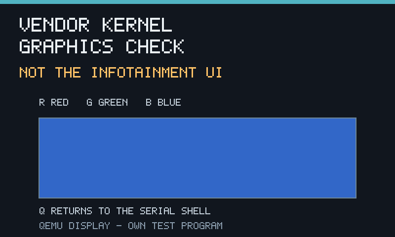

# Local-only graphical I/O on the vendor-kernel VM

2026-10-20. **An 800×480 diagnostic display and virtual keyboard interaction now
work on the VM-adapted `4.1.27-abl` kernel.** No new software or firmware was
downloaded. This is **our test program**, not the infotainment UI, an i915
implementation, or a recovered vendor application.



The warning in the frame is intentional. These screenshots must not be
presented as the Hyundai/LG UI.

## What was demonstrated

1. Boot the existing kernel using the already-verified SDHCI table adaptation
   in guest RAM; mount a fresh, compatible ext4 research root.
2. Execute a freestanding x86-64 Linux diagnostic assembled with the local LLVM
   tools. It has no external library or dynamic-loader dependency.
3. Check for a hypervisor and the expected QEMU VGA identity (`1234:1111`) at
   `0000:00:01.0` before accessing its resources.
4. Map the virtual VGA device's sysfs PCI `resource2` (MMIO) and `resource0`
   (framebuffer); program its Bochs DISPI registers for 800×480×32-bit output.
5. Read R/G/B/Q through the virtual PS/2 keyboard, using a small polling routine
   permitted by guest `ioperm`. Serial input is also accepted.
6. Inject real virtual-keyboard events through QMP, capture the resulting
   frames through QEMU, and compare **every RGB pixel** with the intended frame.
7. Q exits the diagnostic; the guest shell receives exit status zero.

No framebuffer kernel driver, `/dev/fb0`, `/dev/mem`, GPU passthrough, Qt, Mesa
or new guest libraries were used. The identity checks reduce accidental use on
unrelated hardware; they are not a security/attestation boundary.

### Recorded result

The windowed Cocoa run, `work/vm/graphics/runs/1792478185392483000`, reports:

```text
VM_DISPLAY_READY 800x480 BGRX32 - DIAGNOSTIC ONLY
VM_DISPLAY_RED
VM_DISPLAY_GREEN
VM_DISPLAY_BLUE
VM_DISPLAY_EXIT
```

`result.json`: root mounted, userspace reached, command exit 0,
`graphics_passed=true`, no timeout or launcher error.

| State | Center RGB | Whole frame checked |
|---|---|---|
| Initial | 34, 68, 102 | yes |
| Red | 194, 55, 55 | yes |
| Green | 43, 156, 111 | yes |
| Blue | 50, 103, 200 | yes |

The recorded keyboard path is **QMP → emulated PS/2 controller → guest polling
code → framebuffer write → QEMU screenshot**. It is not a host-only image viewer
or a serial command pretending to be a keyboard event. Manual keyboard use in
the Cocoa window is exposed by the same virtual device; mouse/touch input has
not been implemented or verified.

Evidence in [`vm-graphics/`](vm-graphics/):

- `serial.log`, `result.json`, `command.json`, `patch.json`;
- `graphics.json`, containing the QMP transcript and full-frame checks;
- four actual guest screenshots, `display-{idle,red,green,blue}.png`;
- `build.json`, recording the assembler command and source/object/ELF hashes;
- `evidence-sha256.json`.

The host PNG conversion only converts QEMU's captured PPM bytes. The expected
frames are comparison oracles, not substitutes for the captured screenshots.

## Run the interactive window

The prepared local workspace is `work/vm/graphics`:

```sh
/opt/homebrew/bin/python3.13 tools/uk_fw/vm_boot.py run \
  --workspace work/vm/graphics --sdhci-compat \
  --display cocoa --cmd /bin/vm-display --interactive --timeout 0
```

Focus the QEMU window and press **R**, **G**, or **B**. **Q** returns the program
to the serial shell; the last image remains visible. Ctrl-C in the launching
terminal stops the VM. The guest shell remains a minimal line-oriented shell,
not a full terminal/getty setup.

To reproduce the automated, pixel-verified sequence:

```sh
/opt/homebrew/bin/python3.13 tools/uk_fw/vm_boot.py run \
  --workspace work/vm/graphics --sdhci-compat --graphics-smoke
```

Add `--display cocoa` to show a window during the automated sequence. Without
it, QEMU still renders the virtual VGA device for screenshots but creates no
host window. No VNC/TCP listener is needed; QMP and debugger endpoints are
local Unix sockets.

To build a **fresh** workspace entirely from existing local inputs:

```sh
/opt/homebrew/bin/python3.13 tools/uk_fw/vm_boot.py prepare \
  --container /Users/researcher/Downloads/NaU/IONIQ5_EU/HU/images/iasImage_1280_sub \
  --busybox work/vm/busybox --workspace work/vm/graphics-new --graphics-probe
```

Preparation refuses to overwrite earlier work. The original serial-only
`work/vm/bootable` workspace was preserved and re-tested successfully. Both
workspaces' prepared artifact hashes remained unchanged after the runs.

## Code and regression coverage

The original graphics milestone below had 124 tests. The 2026-10-21
continuation passes **137 tests**, with a fresh full-frame/keyboard regression;
see [`local-ui-recovery.md`](local-ui-recovery.md). The screenshots and hashes
retained here still refer to the original run.

- `tools/uk_fw/guest/qemu_display.S`: guest diagnostic source.
- `tools/uk_fw/vm_display.py`: local assembler wrapper, relocation rejection,
  static ELF construction, labelled test background, QMP client and screenshot
  verification.
- `tools/uk_fw/vm_boot.py`: optional diagnostic preparation, fixed VGA BDF,
  Cocoa display and automated graphics check.
- `tests/test_vm_display.py`: 24 additional tests. The complete suite now
  passes **124 tests**, using the existing PlatformIO Python environment.

A real bug was found during the first graphics run: the launcher sent its
status-reporting shell command as a separate input line. The foreground
interactive program consumed that line, turning its `r` characters into red
input events. Commands are now parsed as one shell group before execution.
Regression tests confirm that child input is preserved and failing commands
still report a nonzero status.

Local full-suite log: `work/vm/local-only/tests-all-with-graphics.log`.
The known root-mount compatibility adaptation is unchanged; no additional
kernel-memory patch was needed for graphics or keyboard input.

## Further search of the resources already available

The previous inventory checked headers and archive filenames. This continuation
also scanned **7,134,873,011 bytes across 14 opaque EU/AU payloads**, including
both GUI archives, rootfs archives, AppNavi payloads, updater binaries, update
archives, rwdata and upgrade descriptors.

The scan searched full file contents for ELF, gzip and `ustar` signatures, then
validated x86-64 ELF/program headers, tar checksums, and bounded gzip members or
ELF/tar prefixes. It found one raw ELF magic occurrence and 407 gzip magic
occurrences, but **none passed those candidate checks**. The first 512 bytes of
all **1,571 regular map ZIP members** were also checked; no executable/archive/
QML-prefix candidate was found.

Positive controls detected the existing BusyBox ELF and a small self-generated
gzip member. Results and hashes are in
[`vm-graphics/local-recovery-scan.json`](vm-graphics/local-recovery-scan.json).
The exact script and complete report remain local at
`work/vm/local-ui-scan.py` and `work/vm/local-only/deep-local-ui-scan.json`.

**Limits:** this is a signature-based search, not decryption or a complete
proof of absence. Gzip probes were capped at 64 KiB compressed/output; the ELF
validator targets little-endian x86-64 executables/shared libraries; ZIP member
inspection was prefix-only. Other packing, encoding, nested content or key
recovery routes were not exhausted.

## What this changes—and what it does not

The earlier claim that this kernel could **never display anything in QEMU** was
wrong. Missing `CONFIG_FB` blocks the usual kernel framebuffer path; it does not
prevent a privileged userspace program from driving a virtual PCI display.

However, this diagnostic does **not** supply the DRM/EGL/Qt interfaces the vendor
HMI might require. More importantly, the real GUI binaries, dependencies and
startup environment remain unrecovered from the available packages. Boot,
serial interaction, a window and keyboard-controlled pixels are now verified;
**interaction with the real infotainment UI is still unresolved**.

No physical head-unit access, package downloads, bootloader/signature bypass,
firmware flashing, or new Council/Fable acceptance is claimed.
